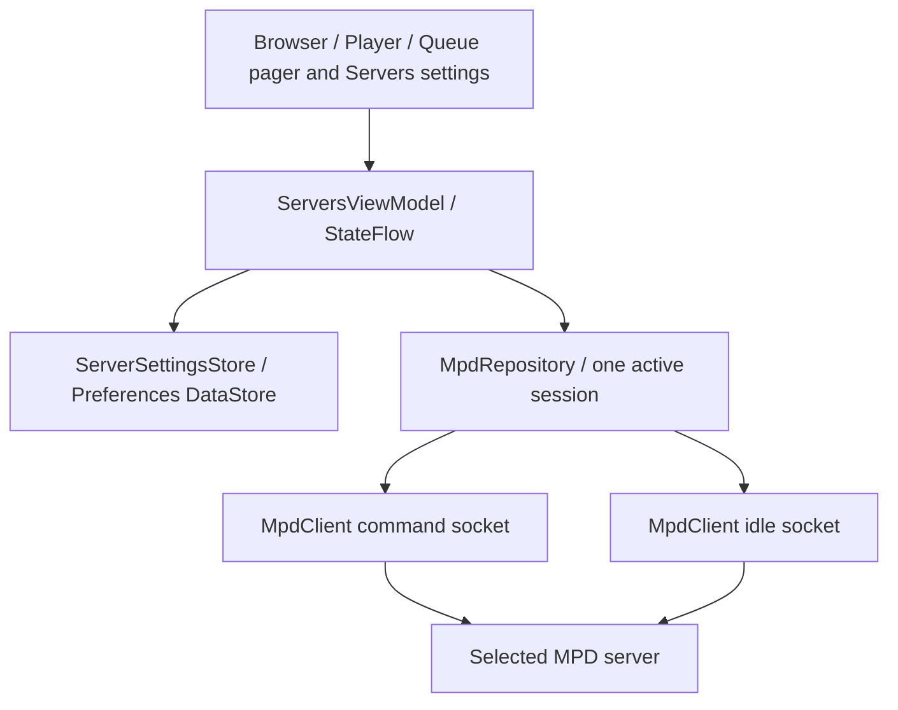

# Architecture

## Existing project

One Android app module, `:app`, under `com.github.jschbe.simplempdplayer`. Kotlin, Compose and Material 3 were already configured. The application ID, namespace, SDK levels, wrapper, repositories and toolchain are preserved.

| Setting | Configuration |
| --- | --- |
| Android | Minimum SDK 31; compile/target SDK 37 |
| Build | Gradle Kotlin DSL, Gradle 9.6.0 with distribution checksum, AGP 9.4.1 |
| JVM | Gradle daemon JDK 25 via Foojay; Java source/target compatibility 11 |
| Compose | Plugin 2.2.10; BOM 2026.02.01 |
| Existing AndroidX | Core KTX 1.19.1, Lifecycle 2.11.0, Activity Compose 1.13.0 |
| M1 additions | Lifecycle ViewModel/Runtime Compose 2.11.0, Preferences DataStore 1.3.0, Coroutines Android/Test 1.10.2 |

Dependencies remain in `gradle/libs.versions.toml`, with stable versions. Google and Maven Central remain the dependency repositories. No MPD library, database, serialization library or DI framework is added. See [requirements](REQUIREMENTS.md) for scope and [README](../README.md) for running the app.

## M1–M3 components and data flow

- `MainActivity` obtains a lifecycle-owned `ServersViewModel`; Compose collects its StateFlow with lifecycle awareness. Activity recreation/recomposition does not create additional connections.
- `ServersViewModel` retains M1 profile editing, persistence and permission handling. The header dropdown changes the persisted selection. Saving a new or edited profile atomically selects it and explicitly reconnects once, even for an unchanged endpoint. A local 500 ms ticker interpolates progress from the last server snapshot using monotonic time, and runs only while connected/playing.
- `ServersApp` uses one HorizontalPager state for Browser–Player–Queue and directly tappable Material 3 tabs. Player is the initial page. With no selected server, it opens Servers instead; Servers is a settings subview with normal Back handling, not a fourth tab. Settings also contains Appearance and an unavailable Sleep timer entry.
- `PlayerScreen` displays server metadata and confirmed state. Seek/volume gestures keep local thumb state and send one command on release; network updates do not override an active seek drag. `QueueScreen` uses MPD IDs as stable keys, locates the current entry on first visible load per server, then preserves user scroll position. Move up/down avoids a drag-and-drop dependency.
- `MpdRepository` owns one session containing command/event clients and an operations Mutex. Old sockets and the idle coroutine are closed/cancelled on switch. Captured session identity guards every asynchronous publication, including command errors; old replies cannot modify a new server's UI. Switching clears the snapshot immediately.
- `MpdModels` defines status, song metadata, queue entries, snapshots and the small `PlayerAction` event type. `MpdData` parses repeated tags and optional fields without flattening queue entries by path. Invalid critical IDs/status numbers fail in a controlled way; unavailable durations/mixers stay nullable.

No foreground service is added. The ViewModel connection can remain while the Activity is stopped, subject to Android process/background limits. Clearing the ViewModel releases both sockets; process restart restores only the selected profile, then loads a fresh MPD snapshot.

## Profiles and persistence

`ServerProfile` has a stable UUID, name, host, MPD port and HTTP stream port. Validation runs without DNS access. Hostnames, IPv4 and IPv6 are accepted; schemes, paths, embedded ports, whitespace and control characters are rejected. Bracketed IPv6 is normalized; international hostnames are converted to ASCII. Port range is 1–65535.

A single application-context `preferencesDataStore` instance stores:

| Key | Value |
| --- | --- |
| `server_profiles_v1` | Ordered text rows: UUID, name, host, MPD port, stream port, separated by tabs; rows separated by newlines |
| `selected_server_id` | UUID of the selected profile, absent when none is selected |
| `recovered_corrupt_file` | Recovery marker when DataStore replaces an unreadable corrupt file |
| `theme_mode` | SYSTEM (default), LIGHT or DARK |

Control characters are invalid profile input, so field delimiters need no custom escaping. No credentials are stored. Decoding skips invalid/duplicate rows, clears dangling selections and reports recovery. Wrong preference types are also treated as invalid input. A successful edit writes a sanitized snapshot. DataStore file corruption resets to empty settings with a warning; an ordinary IO read error shows Retry and disables edits rather than silently replacing data. Changes use DataStore's atomic edit operation.

## Server UI addendum

`ServersViewModel` accepts the settings store, connection factory and permission check explicitly; MainActivity constructs it through the normal ViewModel factory. This keeps the existing lifecycle and permits JVM tests without an Android Application. A settings write suppresses observer-driven connection changes until the atomic edit completes. Save then closes the editor and starts exactly one explicit connection; selection/order/theme edits synchronize only if the selected endpoint changed.

A single empty-list transition flag opens the shared Add server dialog on first load or after deleting the last profile. Cancel does not reset that flag, so recomposition, theme changes and repeated settings emissions cannot reopen it. A new process or a later nonempty-to-empty transition can open it again. Startup with existing profiles never opens it automatically.

The editor's Test action calls `MpdRepository.testConnection`: a temporary client validates greeting/ping and closes in finally, without persisting or touching the active command/idle session. Testing disables repeat submissions and form edits; Cancel cancels the probe. Save selects the stored profile even when its subsequent connection fails. Errors remain in the ordinary connection state. Monotonically increasing operation/dialog tokens reject stale probe results and Connected/Connection failed toast notices; SharedFlow does not replay old notices after Activity recreation.

Servers settings uses the stored row order. Long-press gestures exist only on each drag handle; local visual ordering and edge scrolling run during the gesture. Drop commits the ID order once; cancellation/write failure restores stored order. The store tolerates stale order lists without losing newly added profiles or reviving deleted ones. Reordering does not change selection or reconnect. The header dropdown uses that same persisted order.

Appearance writes the theme preference and applies it directly around the entire Compose hierarchy. SYSTEM follows Android's theme; LIGHT/DARK override it. Existing Material 3 dynamic colors remain in use. No additional theme framework or dependency is introduced.

`SimpleMPDPlayerTheme` updates the Activity window's status/navigation-bar icon appearance in a Compose SideEffect using the effective dark-mode value. It leaves the existing edge-to-edge/inset configuration intact and responds to both explicit and system theme changes.

## M3 browser and queue additions

`MpdBrowserData` splits `lsinfo` records at file/directory/playlist boundaries, reuses song metadata parsing and sorts directories before tracks. Playlist records are skipped with a notice; unknown metadata is ignored. `LibraryEntry` distinguishes directories from tracks; neither requires a queue ID. Unicode and literal backslashes are preserved. The existing `MpdProtocol` argument quoting and `MpdClient` exchange/timeout limits are unchanged. See the [MPD protocol](https://mpd.readthedocs.io/en/stable/protocol.html#the-music-database) for directory listings.

`MpdRepository.browser` is a StateFlow collected into `ServersUiState`. Browser visibility asks the ViewModel to load only when the current listing has not been loaded. Root uses `lsinfo` without arguments; navigation/retry sends `lsinfo <URI>`. Only the current directory's entries are held in memory. Ordinary queue updates, tab changes and recomposition do not reload it; explicit navigation/reconnect obtains fresh data. Library database changes are not watched automatically in M3.

Each session has a child Job for app commands/browser work. Switch/failure closes both sockets and cancels that work. A session generation invalidates UI menus/confirmations and rejects stale UI requests. Directory request numbers additionally reject superseded replies: Up/Back may request a parent while a read is pending. The pending exchange finishes under the operations Mutex, then only the newest queued directory request runs. Navigation does not cancel a healthy shared command socket. A directory ACK is a browser-local error; malformed/transport responses fail the session normally.

`BrowserScreen` renders path/Up, loading, empty, unsupported-playlist and retry states, with a vertical LazyColumn and lightweight queue menus. Its scroll state survives tab changes for the current directory. The existing pager still starts on Player. Back handling is active only for visible Browser subdirectories; dialogs and Servers retain their normal handling.

Append sends one `add <URI>` for files or directories; recursion belongs to MPD. Confirmed replacement sends `clear`, then `add <URI>`, then queue/status readback while holding the same operations Mutex used by playback, browsing, heartbeat and idle refresh. It sends no play command. This excludes app-originated interleaving only: other clients may change MPD state, and there is no transaction or rollback. The operation tracks acknowledged clear/add stages and retains explicit failure feedback. After a confirmed clear, a failed or unconfirmed add is a partial replacement; recursive add may already have inserted some tracks. Lost clear acknowledgements are reported as uncertain. A successful add followed by failed readback is distinguished from an add failure. No mutation is automatically retried, including after switching servers.

## Launcher icon

The supplied `SimpleMPDPlayer.png` above the repository remains untouched. Derived resources separate the bright Play/stream artwork from its precomposed rounded tile. Android supplies the only adaptive mask; the background is a full-bleed dark gradient, and the symbol is padded within the adaptive safe area. Extraction and replacement of the original baked background are pragmatic approximations, not lossless source-layer recovery.

Both launcher variants reference the new adaptive layers. API 33+ resources add a monochrome silhouette for themed icons. Five legacy WebP density variants are included. Generated previews check the circular mask; actual launcher/system-settings appearance still needs a device check when one is available. No image-processing runtime or app dependency is added.

## TCP protocol, synchronization and state

The existing custom TCP client and Android-compatible ACK regex remain in use. UTF-8 decoding, greeting validation, quoting/escaping, bounded responses, IO dispatching and cancellation cleanup are shared by all commands. The text exchange preserves ordered/repeated fields. No MPD library or binary/cover protocol is added. Protocol reference: [MPD specification](https://mpd.readthedocs.io/en/stable/protocol.html).

A client Mutex covers the complete write/flush/read exchange through `OK` or `ACK`. Ordinary operations retain the M1 5-second connect/read and 10-second exchange limits. The separate event client sends `idle` for player, playlist, mixer and options and waits without the short read/exchange deadline; closing it unblocks cancellation. TCP keepalive is enabled. A 15-second ping on the command connection retains M1 liveness detection; there is no per-second network polling or automatic reconnect.

Connection setup validates/pings the command socket, opens the event socket, and loads the initial snapshot. A session operations Mutex groups commands and snapshot refreshes so idle updates cannot split a local command/readback sequence. Each refresh reads status, current song, queue when its version changed, then status again. If the queue version/song identity changed during loading, it retries at most three times. Queue IDs and length are checked; no snapshot is fabricated from partial replies.

Player actions map to explicit commands: state-aware play/pause, stop, previous, next, seekcur, random, repeat and setvol; queue actions use playid/deleteid/moveid/clear. Play/Pause reads current server state before deciding. Seek checks song identity and duration; move resolves the ID against a fresh queue before choosing the adjacent position. Another client's edits cannot be locked out remotely, so ACK failures still require refresh. Mutating commands are never blindly replayed.

Controls disable while disconnected/loading or a user command is pending. A completed ACK rejection leaves the connection usable, displays a command error and refreshes actual server state. A transport, malformed-protocol, security or idle-listener failure closes both sockets and exposes a failed state with manual reconnect. The last snapshot may remain visibly marked as stale; progress stops advancing. An idle ACK also fails the session rather than silently losing external updates.

Responses retain M1's limits of 64 Ki characters per line and approximately 1 Mi characters / 10,000 fields per exchange. Exceptionally large directories/queues and continuously changing snapshots can therefore produce a controlled synchronization error. DNS cancellation and silent network blackholes remain subject to the platform resolver/TCP behavior. M3 does not promise unlimited listing/queue sizes or durable background connections. Large recursive adds are subject to the existing command timeout and may have an uncertain outcome on timeout.

## Security and permissions

The app declares `INTERNET` and, for Android 17 / API 37 and newer, `ACCESS_LOCAL_NETWORK`. The latter is necessary for direct LAN sockets at the existing target SDK 37. Until it is granted, server connections show an actionable permission error; the user can request access from the Servers screen. Permission changes are rechecked when the Activity resumes. See [Android local network permission](https://developer.android.com/privacy-and-security/local-network-permission). Direct MPD TCP is potentially unencrypted. Use a trusted LAN or a separately configured secure tunnel; the app never publishes ports or configures the server. M2 has no passwords, Keystore, encryption dependency, media service, alarm receiver or exact-alarm permission.

HTTP cleartext opt-in is intentionally deferred until HTTP playback exists. It must accommodate user-configured hosts deliberately. Reference: [Android network security configuration](https://developer.android.com/privacy-and-security/security-config#CleartextTrafficPermitted). Existing Android backup settings are preserved; credential storage and backup exclusions must be designed before password support is introduced.

## Later milestones

MPD queue/status snapshots and directory listings are not stored as a local playlist or music library.

HTTP reception is separate from MPD remote control. A later Media3/MediaSessionService will receive one manually enabled stream, with local Android volume independent of MPD volume. Fresh startup leaves it off; disabling local audio does not pause MPD. Buffering can lag behind server metadata/progress. No audio dependency, service or cleartext opt-in is added in M2.

One future sleep timer uses `AlarmManager.setAndAllowWhileIdle()` without exact-alarm permission and sends `pause 1` to the bound server. It works without local audio and must report delayed/failed delivery honestly. M2 exposes only an unavailable settings entry, with no timer infrastructure.

## Open decisions for later work

1. Password storage/authentication and backup/device-transfer exclusions.
2. Paging/windowing for exceptionally large queues; minimum supported MPD protocol version.
3. Stream URL/path, supported encoders, cleartext configuration, reconnection and MediaSession command mapping.
4. Timer behavior when its profile is edited/deleted, device reboot/force-stop, failure presentation and tightly bounded retries. Do not reuse monotonic deadlines across device reboot.
5. Optional directory refresh/database-event observation and paging for exceptionally large listings.

## Verification

JVM tests additionally cover atomic Save/activate/connect, independent probes, stale notices, empty-list setup transitions, ordering and theme persistence. They also cover profile/storage behavior, protocol parsing, playback/queue commands, repeated/Unicode metadata, empty/duplicate-path queues, interpolation, ACK/transport failures, external idle updates, cancellation and stale replies during server switches. Loopback socket tests verify that idle has no ordinary deadline and does not block commands.

M3 JVM tests cover mixed lsinfo records, missing metadata, skipped playlists, exact special-character commands over loopback sockets, ACK recovery, lazy loading, superseded reads, append/replace/readback, serialization against browser/idle/heartbeat work, partial/uncertain failures and cancellation/stale results on switches. Compose fixtures cover folder/Up/Android Back navigation, pager behavior, action menus, confirmation/cancellation, empty/loading/error/disconnected states, stale dialogs and scroll preservation. A window-level test checks system-bar icon contrast after explicit and simulated system theme changes. No automated browser test uses a live MPD server or the normal app's stored profiles.

Android tests cover the ICU ACK regression, player/queue parsing and controlled Compose fixtures for tabs, swipes, empty state, queue selection/actions, settings and seek dragging. Additional controlled ViewModel/UI fixtures cover setup, probe/save, header selection, handle-only dragging, deletion, appearance and launcher-resource rendering. They do not access a real MPD server or stored profiles.

Instrumented tests use the `deviceTest` build type with application-ID suffix `.devicetest`; the normal app is not their install/uninstall target. The same source is used for the debug APK and JVM tests. Because this project's AGP exposes unit tests for the configured test build type, the JVM task is `testDeviceTestUnitTest`. The existing Compose UI test manifest is reused only for the isolated test host. No new dependency coordinates or permissions are introduced.
