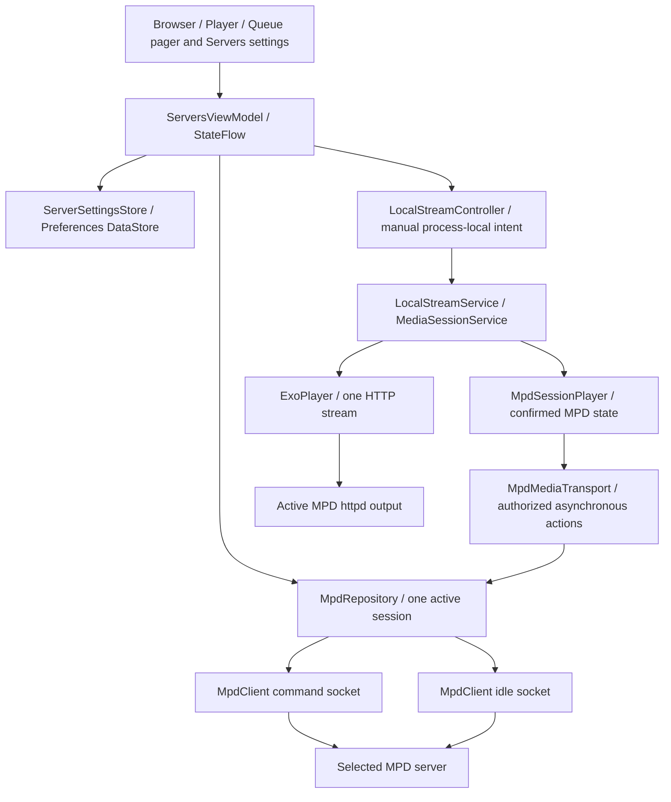

# Architecture

## Existing project

One Android app module, `:app`, under `com.github.jschbe.simplempdplayer`. Kotlin, Compose and Material 3 were already configured. The application ID, namespace, SDK levels, wrapper, repositories and toolchain are preserved.

| Setting | Configuration |
| --- | --- |
| Android | Minimum SDK 31; compile/target SDK 37 |
| Build | Gradle Kotlin DSL, Gradle 9.6.0 with distribution checksum, AGP 9.4.1 |
| JVM | Gradle daemon JDK 25 via Foojay; Java source/target compatibility 11 |
| Compose | Plugin 2.2.10; BOM 2026.02.01 |
| Existing AndroidX | Core KTX 1.19.1, Lifecycle 2.11.0, Activity Compose 1.13.0 |
| M4 additions | Media3 ExoPlayer and Session 1.11.1 |
| M1 additions | Lifecycle ViewModel/Runtime Compose 2.11.0, Preferences DataStore 1.3.0, Coroutines Android/Test 1.10.2 |

Dependencies remain in `gradle/libs.versions.toml`, with stable versions. Google and Maven Central remain the dependency repositories. No MPD library, database, serialization library or DI framework is added. See [requirements](REQUIREMENTS.md) for scope and [README](../README.md) for running the app.

## M1–M6 components and data flow

- `MainActivity` obtains a lifecycle-owned `ServersViewModel`; Compose collects its StateFlow with lifecycle awareness. Activity recreation/recomposition does not create additional connections.
- `ServersViewModel` retains M1 profile editing, persistence and permission handling. The header dropdown changes the persisted selection. Saving a new or edited profile atomically selects it and explicitly reconnects once, even for an unchanged endpoint. A local 500 ms ticker interpolates progress from the last server snapshot using monotonic time, and runs only while connected/playing.
- `ServersApp` uses one HorizontalPager state for Browser–Player–Queue and directly tappable Material 3 tabs. Player is the initial page. With no selected server, it opens Servers instead; Servers is a settings subview with normal Back handling, not a fourth tab. Settings also contains Appearance and the Sleep timer dialog.
- `PlayerScreen` displays server metadata and confirmed state. Seek/volume gestures keep local thumb state and send one command on release; network updates do not override an active seek drag. `QueueScreen` uses MPD IDs as stable keys, locates the current entry on first visible load per server, then preserves user scroll position. Move up/down avoids a drag-and-drop dependency.
- `MpdRepository` owns one session containing command/event clients and an operations Mutex. Old sockets and the idle coroutine are closed/cancelled on switch. Captured session identity guards every asynchronous publication, including command errors; old replies cannot modify a new server's UI. Switching clears the snapshot immediately.
- `MpdModels` defines status, song metadata, queue entries, snapshots and the small `PlayerAction` event type. `MpdData` parses repeated tags and optional fields without flattening queue entries by path. Invalid critical IDs/status numbers fail in a controlled way; unavailable durations/mixers stay nullable.

`PlayerApplication` constructs the production repository with a process-owned Main/SupervisorJob scope and the local stream controller. The Activity ViewModel observes this shared repository; clearing/recreating the Activity cannot destroy a background receiver or stop its metadata updates. A new Activity adopts the already connected endpoint without reconnecting. JVM ViewModel fixtures retain their independently owned repository and close it on clearing. Process death closes all resources; startup restores only profiles/selection and reconnects MPD, never local audio. Without local audio no foreground service keeps the process alive; idle control sockets are process-local and may be reclaimed by Android.

## Profiles and persistence

`ServerProfile` has a stable UUID, name, host, MPD port and HTTP stream port. Validation runs without DNS access. Hostnames, IPv4 and IPv6 are accepted; schemes, paths, embedded ports, whitespace and control characters are rejected. Bracketed IPv6 is normalized; international hostnames are converted to ASCII. Port range is 1–65535.

A single application-context `preferencesDataStore` instance stores:

| Key | Value |
| --- | --- |
| `server_profiles_v1` | Ordered text rows: UUID, name, host, MPD port, stream port, separated by tabs; rows separated by newlines |
| `selected_server_id` | UUID of the selected profile, absent when none is selected |
| `recovered_corrupt_file` | Recovery marker when DataStore replaces an unreadable corrupt file |
| `theme_mode` | SYSTEM (default), LIGHT or DARK |

Control characters are invalid profile input, so field delimiters need no custom escaping. No credentials are stored. Decoding skips invalid/duplicate rows, clears dangling selections and reports recovery. Wrong preference types are also treated as invalid input. A successful edit writes a sanitized snapshot. DataStore file corruption resets to empty settings with a warning; an ordinary IO read error shows Retry and disables edits rather than silently replacing data. Changes use DataStore's atomic edit operation.

## Server UI addendum

`ServersViewModel` accepts the settings store, connection factory and permission check explicitly; MainActivity constructs it through the normal ViewModel factory. This keeps the existing lifecycle and permits JVM tests without an Android Application. A settings write suppresses observer-driven connection changes until the atomic edit completes. Save then closes the editor and starts exactly one explicit connection; selection/order/theme edits synchronize only if the selected endpoint changed.

A single empty-list transition flag opens the shared Add server dialog on first load or after deleting the last profile. Cancel does not reset that flag, so recomposition, theme changes and repeated settings emissions cannot reopen it. A new process or a later nonempty-to-empty transition can open it again. Startup with existing profiles never opens it automatically.

The editor's Test action calls `MpdRepository.testConnection`: a temporary client validates greeting/ping and closes in finally, without persisting or touching the active command/idle session. Testing disables repeat submissions and form edits; Cancel cancels the probe. Save selects the stored profile even when its subsequent connection fails. Errors remain in the ordinary connection state. Monotonically increasing operation/dialog tokens reject stale probe results and Connected/Connection failed toast notices; SharedFlow does not replay old notices after Activity recreation.

Servers settings uses the stored row order. Long-press gestures exist only on each drag handle; local visual ordering and edge scrolling run during the gesture. Drop commits the ID order once; cancellation/write failure restores stored order. The store tolerates stale order lists without losing newly added profiles or reviving deleted ones. Reordering does not change selection or reconnect. The header dropdown uses that same persisted order.

Appearance writes the theme preference and applies it directly around the entire Compose hierarchy. SYSTEM follows Android's theme; LIGHT/DARK override it. Existing Material 3 dynamic colors remain in use. No additional theme framework or dependency is introduced.

`SimpleMPDPlayerTheme` updates the Activity window's status/navigation-bar icon appearance in a Compose SideEffect using the effective dark-mode value. It leaves the existing edge-to-edge/inset configuration intact and responds to both explicit and system theme changes.

## M3 browser and queue additions

`MpdBrowserData` splits `lsinfo` records at file/directory/playlist boundaries, reuses song metadata parsing and sorts directories before tracks. Playlist records are skipped with a notice; unknown metadata is ignored. `LibraryEntry` distinguishes directories from tracks; neither requires a queue ID. Unicode and literal backslashes are preserved. The existing `MpdProtocol` argument quoting and `MpdClient` exchange/timeout limits are unchanged. See the [MPD protocol](https://mpd.readthedocs.io/en/stable/protocol.html#the-music-database) for directory listings.

`MpdRepository.browser` is a StateFlow collected into `ServersUiState`. Browser visibility asks the ViewModel to load only when the current listing has not been loaded. Root uses `lsinfo` without arguments; navigation/retry sends `lsinfo <URI>`. Only the current directory's entries are held in memory. Ordinary queue updates, tab changes and recomposition do not reload it; explicit navigation/reconnect obtains fresh data. Library database changes are not watched automatically in M3.

Each session has a child Job for app commands/browser work. Switch/control failure closes both sockets and cancels that work; isolated idle failure retains it. A session generation invalidates UI menus/confirmations and rejects stale UI requests. Directory request numbers additionally reject superseded replies: Up/Back may request a parent while a read is pending. The pending exchange finishes under the operations Mutex, then only the newest queued directory request runs. Navigation does not cancel a healthy shared command socket. A directory ACK is a browser-local error; malformed/transport responses fail the session normally.

`BrowserScreen` renders path/Up, loading, empty, unsupported-playlist and retry states, with a vertical LazyColumn and lightweight queue menus. Its scroll state survives tab changes for the current directory. The existing pager still starts on Player. Back handling is active only for visible Browser subdirectories; dialogs and Servers retain their normal handling.

Append sends one `add <URI>` for files or directories; recursion belongs to MPD. Confirmed replacement sends `clear`, then `add <URI>`, then queue/status readback while holding the same operations Mutex used by playback, browsing, heartbeat and idle refresh. It sends no play command. This excludes app-originated interleaving only: other clients may change MPD state, and there is no transaction or rollback. The operation tracks acknowledged clear/add stages and retains explicit failure feedback. After a confirmed clear, a failed or unconfirmed add is a partial replacement; recursive add may already have inserted some tracks. Lost clear acknowledgements are reported as uncertain. A successful add followed by failed readback is distinguished from an add failure. No mutation is automatically retried, including after switching servers.

## M4 local audio and session policy

`LocalStreamController` owns only ephemeral enable intent, an increasing generation, request and state StateFlows. Its backend can start/stop local audio but has no MPD command API. Profile URL construction revalidates and normalizes the profile, uses the HTTP root path and stream port, IDN ASCII conversion and proper IPv6 brackets through `URI`; it accepts no scheme/path/credentials/controller-provided URL. The service reads a trusted in-memory request; its Intent contains only the generation. Stream intent is never persisted. `ServersViewModel.connect` disables/releases local audio synchronously before every Save/switch/delete, and includes the stream port in endpoint-change detection. Reordering/theme changes do not interrupt playback. The process owner forwards repository snapshots to the controller even without a visible Activity. Same-server recovery and manual Reconnect retain an enabled receiver while `recovering` is true; terminal control failure stops it; stream failures do not call the repository or close MPD sockets. Generation guards reject stale errors and service destruction.

`LocalStreamService` creates exactly one ExoPlayer and registers one MediaSession with the service. Media3 owns the media notification and foreground promotion. It uses standard media/music audio attributes with automatic audio focus, becoming-noisy handling and network wake mode. Local volume is Android's music stream, separate from MPD setvol. Permanent focus loss/noisy events disable/release local audio; transient suppression is reported and ExoPlayer may resume on focus return. No focus/route/lifecycle callback sends MPD commands. Default Android routing covers speaker, wired headphones and Bluetooth; real accessory behavior still needs manual acceptance.

The service prepares the profile stream even when MPD is paused, but `playWhenReady` follows confirmed MPD PLAYING only. Paused/stopped/unknown snapshots pause local output and report Waiting for MPD when ready. HTTP can still supply silent MP3 frames while MPD is paused. On resume ExoPlayer stops/prepares the same item to reopen the live origin and discard accumulated silence. MPD metadata is published separately from the decoder; embedded MP3 ID3/artwork extraction remains disabled. Audio buffering and MPD event timing can make sound lag behind the display.

### M6 session facade and command routing

`MpdSessionPlayer` extends Media3 1.11.1 `SimpleBasePlayer`, rather than forwarding ordinary player commands to ExoPlayer or relying on a UI/session-command callback. It supplies its own confirmed MPD state and current-item metadata and has no reference to a decoder. `SimpleBasePlayer` manages the corresponding listener events, which MediaSession uses for the platform session/notification. The service combines stream requests and repository state so external idle updates, command completion/pending state and M5 pauses reach the facade without Activity collectors or new polling. The session represents MPD PLAYING/PAUSED/STOPPED as Ready+playing/Ready+paused/Idle; HTTP buffering, focus suppression and local playWhenReady never become MPD status.

`handleSetPlayWhenReady` routes Play/Pause and `handleSeek` routes only the four next/previous variants to `MpdMediaTransport`. Media3's next/previous API uses seek-command identifiers, including INDEX_UNSET for a single current item; those are interpreted as remote next/previous intent, never a local position. Only one descriptive current MPD item is exposed, with unknown duration, a constant position supplier and no stream URI or seekable timeline. There is no copied queue or fabricated adjacent item. The app retains its MPD-derived progress display; system/controller interpolation cannot promise stream timing.

The main-thread transport captures the stream generation/profile. It accepts only Play, Pause, Toggle, Next and Previous and calls the existing asynchronous `MpdRepository.perform`. That method returns its session-owned Job and rechecks authorization/current session under the operations mutex, and again after the fresh status read used by explicit Play/Pause/Toggle. Play sends `pause 0` from paused or `play` from stopped; Pause sends `pause 1` only from playing; same-state commands do nothing. Toggle reads MPD, never ExoPlayer. The same repository path handles app transport, readback, ACK errors, idle and cancellation. The facade's command future completes after the repository job; its placeholder state deliberately preserves confirmed data rather than manufacturing optimistic success or track transitions. MediaController clients may briefly mask their own requested state until the operation completes.

Every controller, including the notification/platform controller, receives only metadata/current-item/timeline reads plus Play/Pause and next/previous; actual availability is intersected with the facade's connected/nonpending/known-state commands. Stop, seek positions, local volume, prepare, item replacement/queue changes and custom session commands are unavailable. No control action directly calls ExoPlayer. Only the service's confirmed snapshot observer changes local output. No focus, noisy-route, stream error or session lifecycle callback sends MPD mutations. Local Off synchronously releases the session/decoder and revokes the generation. Repository switching cancels old jobs/closes sockets and rejects late results; operations not yet sent lose authorization, while bytes already sent cannot be recalled.

The notification uses Media3's system rendering and existing immutable Activity PendingIntent. No artwork, custom lock screen, resumption receiver, boot restart, new service, permission or dependency is added. Play/Pause and headset-hook key events preserve toggle intent through a narrow `onMediaButtonEvent` handler and the same generation-bound transport, reading fresh MPD status even before an external idle event arrives. Key-up/repeated key-down events do not send another command. Explicit media Play/Pause are validated again against fresh MPD status. Ordinary commands use the facade regardless of this key-event callback. The service remains non-exported; platform session routing works through Android's media-session token, while binding/controllers alone cannot authorize local reception. System/OEM versions determine notification/lock-screen layout and accessory delivery. Reference: [Media3 custom Player and SimpleBasePlayer](https://developer.android.com/media/media3/session/player).

HTTP uses Media3's default HTTP data source (8 s connect/read deadlines; cross-protocol redirects disabled), zero automatic load-error retries and a 20 s continuous connect/buffering watchdog. Sanitized error categories never expose response bodies/endpoints. Media3 library logging is disabled centrally so source exception details cannot bypass this policy. EOF, decode/transport failure, permission/start failure or terminal loss of MPD terminate local reception and require a manual retry. Off immediately releases player/session, removes the notification/foreground state and stops the service. It is START_NOT_STICKY. Active playback survives task removal; an idle/paused task removal stops it. Android may reclaim a long-paused service, and foreground/audio-focus restrictions can block a background resume. The app reports failure and requires opening the app/retry rather than circumventing platform rules. The target/min SDK and Android routing/focus rules are unchanged.

References: [Media3 stable releases](https://developer.android.com/jetpack/androidx/releases/media3), [MediaSessionService lifecycle/notification/controller commands](https://developer.android.com/media/media3/session/background-playback), [audio focus](https://developer.android.com/media/optimize/audio-focus), [ExoPlayer error policy](https://developer.android.com/media/media3/exoplayer/customization).

## M5 sleep timer

`PlayerApplication` explicitly constructs one process-scoped `SleepTimerController`; alarm delivery stays independent of the interactive repository, local stream and Activity. It observes timer/profile DataStore flows so edits invalidate alarms even without a visible Player. `ServersViewModel` exposes the controller StateFlow and UI events; only an active timer has a local display ticker, with no network polling or background service. `SleepTimerDialog` uses existing Material 3 theme/strings and one dialog for the switch, presets, custom input, target, countdown, estimated time and status. No dependency or permission is added.

`SleepTimerStore` owns a separate `sleep_timer.preferences_pb` Preferences DataStore containing last applied minutes (30 by default; 1–1440), one validated timer record, and a recovery marker. The record holds a UUID generation, profile ID/name/host/MPD port/HTTP port snapshot, boot count, elapsed timestamp, nullable deadline, status and sanitized error category. Existing numeric-deadline v1 records remain readable; WAITING encodes an empty deadline field in the same fixed-field record. It contains no credentials. The endpoint snapshot is needed for the single alarm, not a second interactive server session. Both backup rule formats exclude this file from cloud backup/device transfer to prevent replay on another device. Corrupt records/types are recoverable; ordinary IO read failures expose Retry without replacing data.

Time uses `SystemClock.elapsedRealtime()` including deep sleep. `Settings.Global.BOOT_COUNT` identifies the boot; if unavailable, a new timer cannot start. Startup cancels a pending record with another boot or an invalid elapsed reference. The wall clock is used only for a fresh estimated due time. Active state is restored without re-registering/resetting the OS alarm. Zero remaining time stays Due/Waiting for Android until actual delivery. Force Stop is not guaranteed survivable; a missing PendingIntent is detected, but an extant PendingIntent does not prove Android will deliver the alarm.

`AndroidTimerScheduler` uses one explicit, immutable broadcast PendingIntent with a fixed identity and the generation in extras. Replacing it cancels the old PendingIntent, then uses `setAndAllowWhileIdle(ELAPSED_REALTIME_WAKEUP, deadline, pendingIntent)`. The receiver is non-exported. No SCHEDULE_EXACT_ALARM, USE_EXACT_ALARM, RECEIVE_BOOT_COMPLETED, exact-permission screen or new foreground service exists. Each registration first persists ARMING, cancels the previous OS token, schedules the new token and commits ACTIVE. These two systems cannot be committed atomically: interrupted ARMING is detected and cancelled, never silently rearmed. Cancellation commits terminal state before cancelling the OS token; even an event already queued is rejected by generation/status checks.

A shared coroutine Mutex serializes timer operations and every `ServerSettingsStore` write across instances. Profile selection does not change the bound target. Host, either port or deletion cancels the alarm; renaming/sorting/theme changes do not. A changed duration keeps the original target and starts a new generation, counting down from now only if that target is confirmed Playing, otherwise waiting without a deadline. The observer re-reads current state under the mutex, and dispatch revalidates the current profile under that same lock. Delayed observer events cannot cancel a newer timer. Early, stale and duplicate events send nothing.

`SleepTimerReceiver` uses `goAsync()` and a single IO coroutine bounded to 8 s, finishing the PendingResult in finally. It does not initialize an Activity, ExoPlayer or interactive MPD connection. `MpdRepository.pauseForTimer` creates a disposable existing `MpdClient` with 2 s connect/read deadlines and a 2.5 s exchange limit; the complete resolver/connect/greeting/pause operation has a 6 s deadline. Android's cancellable `DnsResolver` handles hostnames rather than a potentially unbounded blocking JVM resolver; numeric IPv4/IPv6 endpoints bypass DNS. One resolved address is attempted, with no retry/fallback loop. Existing greeting, UTF-8, response bounds, command quoting and ACK parser are reused. The sole command is MPD `pause 1` (the existing encoder quotes its numeric argument as `pause "1"` on the wire). There is no status-dependent toggle or Play/Stop/queue/seek/output command. Empty acknowledged response is required for success; password/permission ACKs have an explicit unsupported-authentication error.

Delivery persists DELIVERING before IO while holding the mutation lock until its bounded outcome is stored. If cancellation/restart/profile edit commits first, the old alarm cannot send. If delivery claims first, UI changes wait for that attempt (normally under 6 s plus local persistence); an already transmitted command cannot be recalled. A process killed after claim may have sent Pause without persisting its acknowledgement. Startup marks that claim uncertain and never replays it, even though explicit Pause is idempotent. Timeouts/lost replies also do not imply the server was unchanged. Storage failure cannot fabricate success. There is no automatic retry, notification, background toast or second foreground service. M4 changes only through its ordinary server pause snapshot/idle observation.

Doze/Battery Saver may delay inexact alarms substantially. The short temporary alarm allowance does not guarantee network access or delivery, and OEM restrictions, permission revocation, Force Stop and unavailable DNS/LAN/MPD remain limits. No receiver coroutine is intentionally detached after completion. Disk/OS stalls and process termination cannot be made transactional with a remote server. These limitations are shown in the UI and terminal errors remain inspectable after reopening.

References: [AlarmManager and inexact idle alarms](https://developer.android.com/reference/android/app/AlarmManager#setAndAllowWhileIdle(int,long,android.app.PendingIntent)), [BroadcastReceiver.goAsync](https://developer.android.com/reference/android/content/BroadcastReceiver#goAsync()), [BOOT_COUNT](https://developer.android.com/reference/android/provider/Settings.Global#BOOT_COUNT), [DnsResolver](https://developer.android.com/reference/android/net/DnsResolver).

## M6 addendum: waiting timer and compact Player

WAITING is an enabled, pending timer record with boot/arming timestamp and `deadline = null`. It owns no AlarmManager PendingIntent. On/changed duration uses a confirmed playback supplier under the existing profile/timer mutation mutex. The supplier accepts only CONNECTED, network-available status for the matching bound profile ID/host/MPD/stream ports. Paused/Stopped/unknown/unobserved targets wait. A waiting-to-playing transition creates a new generation and monotonic start/deadline, then uses the existing ARMING/persist/register/ACTIVE sequence. An already ACTIVE record never restarts from later status changes. The unchanged receiver accepts only the current ACTIVE token and sends one explicit `pause 1` even if MPD is now paused/stopped.

The process owner observes the existing repository StateFlow and invokes `playbackChanged` only meaningfully while waiting; it carries no captured event snapshot. Refresh re-reads current timer/settings/playback under the mutation mutex, so queued old/double idle events, Off, duration edits and profile changes cannot resurrect or duplicate a countdown. Foreground timer refresh no longer cancels an active storage observer mid-registration; a healthy observer stays in place and a refresh queues behind the lock. IO-error observer completion can still be retried. Only ACTIVE display state has a UI ticker; waiting adds no polling. The repository recovery implementation, retry budget and control/idle separation are unchanged.

Waiting survives storage/process reload with the same token and no alarm. Reboot/invalid elapsed reference, endpoint edits/deletion, stale alarm rejection, missing alarm detection for ACTIVE, durable DELIVERING claims, backup exclusions and no retry of uncertain delivery all remain. A receiver-only process does not initialize interactive MPD: the injected playback supplier checks whether the repository lazy delegate is already initialized. No new permission, dependency, service or wake lock is added.

Waiting cannot detect a server-side transition while the process is dead/suspended, or while a different server is the single interactive selection. The next resume/reconnect/selection reconciles confirmed status: if still Playing, the full duration starts from this detection time. A play/pause episode completed before observation can be missed. Previously started alarms retain their deadline across normal same-boot process restarts. This is deliberately not a server-side scheduler, and Android alarm/background restrictions remain.

`SleepTimerDialog` uses one Material 3 ExposedDropdownMenu for presets/Custom, with numeric custom input and IME Done. A valid IME Done and the dialog Done both call `setMinutes`; neither calls `setEnabled`. Invalid values stay unapplied; the explicit Custom Apply button is removed. The independent switch uses the last applied value. An unchanged value is idempotent, including IME Done followed by dialog Done. Saved custom-mode/text state survives Activity recreation without firing callbacks.

`PlayerScreen` puts MPD and sleep state on one weighted row with single-line ellipsis (full semantic text remains available), uses compact remaining minutes, and shows waiting distinctly. Listen on phone has its own 48 dp info button/dialog beside the label; the containing row does not toggle reception, and the persistent explanatory paragraph is removed. Random remains a label/switch group beside a compact Repeat dropdown in a FlowRow: one row when they fit, whole-control wrapping for narrow/large-text layouts. Dropdown text can wrap within its available width. Existing MPD commands remain authoritative.

Track metadata uses a minimum-48-dp accessible expand/collapse row, decorative chevron, labeled action and expanded/collapsed state description. Expanded typography retains title/artist/album; collapsed shows only title/filename with smaller typography and bounded lines. The global `track_info_expanded` boolean defaults to true in the existing server Preferences DataStore. Raw-type decoding recovers invalid input, and ordinary read failures preserve stored data. ViewModel/store callbacks persist the preference without changing endpoints or connecting; title/server/status updates do not reset it. No separate preference framework or local metadata cache is added.

## Launcher icon

The supplied `SimpleMPDPlayer.png` above the repository remains untouched. Derived resources separate the bright Play/stream artwork from its precomposed rounded tile. Android supplies the only adaptive mask; the background is a full-bleed dark gradient, and the symbol is padded within the adaptive safe area. Extraction and replacement of the original baked background are pragmatic approximations, not lossless source-layer recovery.

Both launcher variants reference the new adaptive layers. API 33+ resources add a monochrome silhouette for themed icons. Five legacy WebP density variants are included. Generated previews check the circular mask; actual launcher/system-settings appearance still needs a device check when one is available. No image-processing runtime or app dependency is added.

## TCP protocol, synchronization and state

The existing custom TCP client and Android-compatible ACK regex remain in use. UTF-8 decoding, greeting validation, quoting/escaping, bounded responses, IO dispatching and cancellation cleanup are shared by all commands. The text exchange preserves ordered/repeated fields. No MPD library or binary/cover protocol is added. Protocol reference: [MPD specification](https://mpd.readthedocs.io/en/stable/protocol.html).

A client Mutex covers the complete write/flush/read exchange through `OK` or `ACK`. Ordinary operations retain the M1 5-second connect/read and 10-second exchange limits. The separate event client sends `idle` for player, playlist, mixer and options and waits without the short read/exchange deadline; closing it unblocks cancellation. TCP keepalive is enabled. A 15-second ping on the command connection retains M1 liveness detection; there is no per-second network polling. Transient failures use the bounded recovery below.

Connection setup validates/pings the command socket, opens the event socket, and loads the initial snapshot. A session operations Mutex groups commands and snapshot refreshes so idle updates cannot split a local command/readback sequence. Each refresh reads status, current song, queue when its version changed, then status again. If the queue version/song identity changed during loading, it retries at most three times. Queue IDs and length are checked; no snapshot is fabricated from partial replies.

Player actions map to explicit commands: state-aware play/pause, stop, previous, next, seekcur, random, repeat/single and setvol; queue actions use playid/deleteid/moveid/clear. Play/Pause reads current server state before deciding. Seek checks song identity and duration; move resolves the ID against a fresh queue before choosing the adjacent position. Another client's edits cannot be locked out remotely, so ACK failures still require refresh. Mutating commands are never blindly replayed.

`MpdStatus` retains nullable repeat and a typed single state (Off/On/Oneshot/Unknown), deriving only exact supported pairs into `RepeatMode` (None/Queue/Single). Missing/unexpected values remain unknown; `repeat 0` with `single 1` is shown as Stop after track, and oneshot is shown explicitly. Status reads and idle refreshes never normalize options. The dropdown displays only confirmed state, has three selectable modes, and stores no preference. Its Material 3 controls use existing System/Light/Dark themes and string resources.

`PlayerAction.Repeat` reads fresh status while holding the existing session operations Mutex, sends `repeat` then `single` only where the target differs or the field is unknown, then uses ordinary snapshot readback. Targets are 0/0, 1/0 and 1/1 respectively. Random sends only `random` and Repeat never writes it. The lock also excludes browser work, idle refreshes, heartbeat and media commands across the full sequence/readback. ACK aborts remaining writes and triggers actual readback even after partial success. Transport/readback failure closes both sockets; ordinary recovery reloads state without replaying either mutation. Other MPD clients may still intervene; this is neither a transaction nor rollback. Cancellation/session checks between writes prevent continuation after switching servers.

Controls disable while disconnected/loading or a user command is pending. A completed ACK rejection leaves the connection usable, displays a command error and refreshes actual server state. A control transport, malformed-protocol or security failure closes both sockets; an idle-only failure closes just the event socket. Transient errors enter bounded recovery; malformed/permission errors retain manual reconnect. The last snapshot may remain visibly marked as stale; progress stops advancing. An idle ACK is shown as a non-retried idle failure while healthy control remains available.

Responses retain M1's limits of 64 Ki characters per line and approximately 1 Mi characters / 10,000 fields per exchange. Exceptionally large directories/queues and continuously changing snapshots can therefore produce a controlled synchronization error. DNS cancellation and silent network blackholes remain subject to the platform resolver/TCP behavior. M3 does not promise unlimited listing/queue sizes or durable background connections. Large recursive adds are subject to the existing command timeout and may have an uncertain outcome on timeout.

## Connection-loss diagnosis and bounded recovery

The original failure path was reproducible from the code and fixtures: idle and heartbeat were children of one ordinary coroutine scope. An idle EOF/exception cancelled the entire scope, closed the command socket as well, published only a generic Connection lost, and caused `LocalStreamController` to release ExoPlayer/session. Activity resume only checked permissions/timer, leaving the failure latched until manual Reconnect. Neither Activity pause nor locking intentionally closed the shared repository; idle already used no short read deadline. Ordinary command reads retain 5-second socket and 10-second exchange deadlines, and keepalive/heartbeat cannot prevent OS/OEM/network socket loss. The original Connection lost label maps specifically to EOF/SocketException; timeouts already have a separate error category, but the old UI could not distinguish command versus idle origin. No incident-specific handset trace was supplied, so the original initiating socket/network cause is unconfirmed; do not attribute it to a specific OEM policy. No real MPD traffic is needed to reproduce and fix the teardown behavior.

`ConnectionState.failureSource` distinguishes CONNECT, CONTROL and IDLE; the existing error category distinguishes timeout, EOF/socket, refusal, protocol and permissions. Retry count/recovering/exhausted, idle-connected and network-wait flags make repair state explicit without recording endpoint/response/exception details. UI shows these sources and cached-state warnings rather than raw errors. No persistent diagnostic logging or telemetry is introduced.

Each command session has a SupervisorJob with independently handled idle listener and existing heartbeat. Idle read/connect failures close only the event client; commands/browser mutations keep the same command client and operations mutex. Only command setup/readback/heartbeat failure closes both clients and cancels session work. One generation-bound recovery Job handles either path: delays 1/2/4/8/16 seconds, at most five attempts, with the same budget if idle repair escalates to full repair. A successful connect, full snapshot readback and idle subscription reset the budget. Permanent protocol/ACK/permission failures are not retried. Full recovery creates fresh clients; idle recovery only creates an event client. Both force queue readback even if MPD reuses the previous version. Idle observation is started alongside the final readback to minimize the resubscription gap. A silently blackholed idle TCP socket still depends on OS failure detection or a later network/socket error; the app adds no idle polling deadline.

Explicit connect/switch/close and manual restart cancel pending recovery immediately and change the selection generation. Session identity/closed checks reject late replies; old command Jobs are never rebound to a new session. Mutations are not replayed, including a command whose acknowledgement timed out. Browser generations invalidate stale menus; failure/partial-operation notices survive failure until a subsequent reconnect/readback. A manual same-server `reconnect` resets the budget immediately and retains the old snapshot/recovering state without an intermediate local-audio disable. After exhaustion, network/foreground events do not create a new cycle; manual Reconnect is required.

`MpdNetworkObserver` is a single process-lifetime passive ConnectivityManager callback, created with the repository. ACCESS_NETWORK_STATE is a normal permission. A capability-unrestricted NetworkRequest includes LAN-only Wi-Fi/VPN rather than requiring validated Internet. Callback bookkeeping and the initial available-network snapshot are serialized on Main; no synchronous network queries occur in callbacks. Known absence suspends attempts without consuming another slot and skips heartbeat/check attempts. Unknown state remains permissive and socket failures remain bounded. No network is requested, bound or kept awake. Presence of a network does not prove this server is reachable. Reference: [Android network-state callbacks](https://developer.android.com/develop/connectivity/network-ops/reading-network-state).

`MainActivity` delegates ON_RESUME to `ServersViewModel.onForeground`: permission/timer refresh plus one repository health check. The session's single-flight check serializes ping/full readback with other operations and triggers the same repair loop only on failure. Healthy control and idle sockets survive ordinary foreground/Activity recreation. Network return requests the same check. No new periodic task/service exists: the old 15-second command heartbeat remains while the process/session lives; retries are cancellable delays/flow waits, not durable scheduled work.

`LocalStreamController` retains an existing manually authorized request with its last confirmed snapshot during same-server recovery. The process owner continues forwarding actual snapshots; the existing service does not recreate ExoPlayer, HTTP or MediaSession when only control changes. A snapshot changing MPD play/pause still drives the normal local pause/live-origin resume policy. M6 transport checks connectivity/network availability; unavailable control cannot send commands. Terminal full-control failure releases local audio; exhausted idle-only repair can retain healthy control/audio with a visible warning. Off/profile changes and HTTP/focus/audio failures retain their separate existing cleanup/manual-retry behavior. Process death and Android background/network restrictions still apply; no resumption or background availability guarantee is added. M5 timer state/delivery is unchanged.

## Security and permissions

The app declares `INTERNET` and, for Android 17 / API 37 and newer, `ACCESS_LOCAL_NETWORK`. The latter is necessary for direct LAN sockets at the existing target SDK 37. Until it is granted, server connections show an actionable permission error; the user can request access from the Servers screen. Permission changes are rechecked when the Activity resumes. See [Android local network permission](https://developer.android.com/privacy-and-security/local-network-permission). Direct MPD TCP is potentially unencrypted. Use a trusted LAN or a separately configured secure tunnel; the app never publishes ports or configures the server. M4 adds FOREGROUND_SERVICE, FOREGROUND_SERVICE_MEDIA_PLAYBACK and WAKE_LOCK for Media3 background audio. Media-session notifications are exempt from the Android 13 notification runtime permission, so POST_NOTIFICATIONS is not requested. M5 adds one non-exported alarm receiver without new permissions. Connection recovery adds only the normal ACCESS_NETWORK_STATE permission for passive network hints. There are still no passwords, Keystore, encryption dependency, boot receiver or exact-alarm permission.

`network_security_config.xml` deliberately enables cleartext in the base configuration. User profiles permit arbitrary hostnames, IPv4 and IPv6; Android static domain configuration cannot enumerate future user-entered endpoints at runtime. This application-wide opt-in is limited in purpose to the manually enabled HTTP receiver; no credentials are sent and there is no WebView, telemetry or other HTTP feature. It does not secure the LAN transport. Reference: [Android network security configuration](https://developer.android.com/privacy-and-security/security-config#CleartextTrafficPermitted). Existing Android backup settings are preserved; credential storage and backup exclusions must be designed before password support is introduced.

## Later milestones

MPD queue/status snapshots and directory listings are not stored as a local playlist or music library.

M5 implements the single inexact sleep timer described above. Password support remains future work.

## Open decisions for later work

1. Password storage/authentication and backup/device-transfer exclusions.
2. Paging/windowing for exceptionally large queues; minimum supported MPD protocol version.
3. Additional HTTP encoder/device validation; M4 supports only a root-path stream; M6 adds bounded system transport while retaining that receiver.
4. Wider OEM/Doze/permission testing; M5 deliberately makes one bounded delivery attempt without retries.
5. Optional directory refresh/database-event observation and paging for exceptionally large listings.

## Verification

JVM tests additionally cover atomic Save/activate/connect, independent probes, stale notices, empty-list setup transitions, ordering and theme persistence. They also cover profile/storage behavior, protocol parsing, playback/queue commands, repeated/Unicode metadata, empty/duplicate-path queues, interpolation, ACK/transport failures, external idle updates, cancellation and stale replies during server switches. Loopback socket tests verify that idle has no ordinary deadline and does not block commands.

M3 JVM tests cover mixed lsinfo records, missing metadata, skipped playlists, exact special-character commands over loopback sockets, ACK recovery, lazy loading, superseded reads, append/replace/readback, serialization against browser/idle/heartbeat work, partial/uncertain failures and cancellation/stale results on switches. Compose fixtures cover folder/Up/Android Back navigation, pager behavior, action menus, confirmation/cancellation, empty/loading/error/disconnected states, stale dialogs and scroll preservation. A window-level test checks system-bar icon contrast after explicit and simulated system theme changes. No automated browser test uses a live MPD server or the normal app's stored profiles.

Android tests cover the ICU ACK regression, player/queue parsing and controlled Compose fixtures for tabs, swipes, empty state, queue selection/actions, settings and seek dragging. Additional controlled ViewModel/UI fixtures cover setup, probe/save, header selection, handle-only dragging, deletion, appearance and launcher-resource rendering. They do not access a real MPD server or stored profiles.

Instrumented tests use the `deviceTest` build type with application-ID suffix `.devicetest`; the normal app is not their install/uninstall target. The same source is used for the debug APK and JVM tests. Because this project's AGP exposes unit tests for the configured test build type, the JVM task is `testDeviceTestUnitTest`. The existing Compose UI test manifest is reused only for the isolated test host. M4 adds only the two Media3 dependency coordinates and the permissions described above.

### M4 verification and acceptance limits

JVM coverage includes hostname/IPv4/IPv6/IDN URL construction and rejected profiles, manual intent, connect/buffer/ready/off/error state changes, manual retry, stale generation callbacks, metadata updates, connection loss and synchronous release before server switching/reconnect. ViewModel tests prove local enable/disable does not send MPD commands. Android tests use a generated CC0 mono 44.1 kHz / 128 kbit/s MP3 tone over an in-process HTTP server and a read-only MPD fixture. They cover real decoding, buffering, initial MPD pause, pause/resume, HTTP 503, stalled HTTP/read timeout, no retries, Activity recreation without another HTTP request, Home/screen-off reception, foreground/service/socket shutdown, reconnect/deletion, MPD metadata/unknown stream duration, rejected MediaController commands and media keys, transient/permanent audio focus and unauthorized service/controller starts. Compose tests cover the independent listening switch, status/error/retry and disconnected state. Fixtures only write to the isolated test app's profiles.

`LiveStreamReadOnlyTest` is optional and skipped without explicit `readOnlyStreamHost` instrumentation arguments (optional `readOnlyMpdPort` / `readOnlyStreamPort`). It never persists its endpoint. It passively reads HTTP and starts only repository read/idle traffic, then prepares the local decoder. It never invokes MPD transport/queue/options/volume/output mutations and makes no claim to restore concurrently changed server state. Do not use a physical device for this test. The live server's paused state proves neither audible music nor end-to-end speaker output.

Emulator validation uses the existing Medium Phone AVD, API 36, and the `.devicetest` app. Hardware Bluetooth/headphone switching, actual becoming-noisy delivery and audibility on a phone remain manual acceptance checks; a shell broadcast is not a substitute for a genuine route change. API 31/37 runtime behavior is built/linted but not exercised on those OS versions in this run. HTTP/MPD reachability, encoder support, stream latency, OEM battery policies and long-pause/background focus restrictions remain environmental limits. This M4 verification predates M5; password support remains excluded.

Verified on 2026-11-22: debug build, all 90 JVM tests, the complete 36-test Android fixture suite and a subsequent focused eight-test service run passed on Medium Phone / API 36. Lint completed with zero errors and 19 warnings (including the deliberate cleartext configuration and existing dependency/resource warnings); diff whitespace checks passed. The separate opt-in live test also passed: HTTP 200 / audio/mpeg, 16,384 bytes received by Android and Media3 ready in WAITING_FOR_MPD while the server reported PAUSED. A NUC-only passive HTTP check received 65,536 bytes. No live MPD mutations, SSH, physical-device testing or writes to normal app profiles were performed. This does not verify audible music, physical routing, minimum-API runtime behavior or API 37 permission enforcement.

### M5 verification

Verified on 2026-11-22: debug build, 111 JVM tests and Lint passed (0 errors, 19 existing/deliberate warnings). The full Medium Phone API 36 suite executed 42 Android tests successfully; the optional M4 live-LAN check and two host-driven process-probe phases were skipped unless explicitly enabled. The final focused run passed all six M5 Android tests. All active timer tests used loopback fake MPD only; the real server was neither contacted nor modified during M5. No physical device or normal app profile was used.

JVM cases cover duration/default/presets/invalid custom input, one alarm, start/cancel/reset, wall-clock changes and overdue display, same-boot reload without rescheduling, reboot/invalid monotonic references, missing alarm/boot information, original target across selection and duration changes, rename/order versus endpoint edit/delete, old/early/duplicate events, serialized cancellation/edit versus an already claimed dispatch, interrupted registration/delivery, ACK/authentication/network/timeout errors and ordinary storage failure. Disk reload and malformed timer records are checked. Loopback wire tests validate the greeting, exactly one explicit Pause, no other mutation and socket closure.

Android cases cover creation/cancellation/real PendingIntent identity, receiver execution without Activity or local audio, duplicate delivery, stale/cancelled PendingIntents, endpoint invalidation, persisted ACK/read-timeout failures, absence of exact/boot permissions and exported receiver, presets/custom validation, Activity recreation, stored duration, and System/Light/Dark dialog behavior. Receiver tests shorten only their test record's deadline and explicitly send the real PendingIntent; they do not promise a fixed Doze execution delay.

The opt-in `SleepTimerProcessProbe` was also exercised by a host driver with an ephemeral NUC loopback fake (emulator bridge only). After preparation, a normal `.devicetest` Activity process was terminated under its own test UID without Force Stop, then restarted normally: PID changed while UUID, elapsed deadline and OS alarm registration remained unchanged, and Player displayed the restored countdown. The fake received zero mutations; probe cleanup cancelled the timer. This verifies process survival rather than just reconstructing a controller in the same process. Reboot detection is unit-tested; a physical reboot, real Doze/OEM delays and API 31/37 runtime behavior are not exercised here.

### M6 verification

Verified on 2026-11-22 with the existing Medium Phone AVD (`medium_phone`, API 36), dynamically identified as `emulator-5554`. The Gradle wrapper debug build, all 114 JVM tests and Lint passed (0 errors, 19 existing/deliberate warnings); whitespace checks passed. The full isolated `.devicetest` suite passed its 48 active fixtures; the optional live-LAN test and two opt-in process-probe phases were not enabled. Following the final toggle-routing addition, all 15 focused service tests passed again with the final build/JVM/Lint run. No real MPD endpoint was contacted.

New JVM cases verify explicit Play/Pause mapping/no-ops against fresh server status, authorization expiry while waiting for status, revoked receiver generations, unsupported mutations and cancellation before a server switch. Existing stale-response, command/readback and idle tests remain in place. Android service tests exercise real MediaController calls, actual notification PendingIntents/platform-session metadata/actions, Android media-key Play/Pause/Toggle/Next/Previous, fresh-status Toggle before delayed external idle, toggle during decoder focus suppression, all next/previous command variants, stopped Play, ACK rejection with confirmed state retained, continuous HTTP bytes during MPD Pause, external title/artist changes and filename fallback, M5 one-shot Pause reflected through idle, Off during a blocked status read, disconnected/old controllers and server switch. Read-only assertions remain on activation/deactivation, focus loss, errors, unauthorized starts and lifecycle tests. Existing screen-off/background, Activity recreation, HTTP deadline/retry and foreground/service/socket release tests pass.

Hardware Bluetooth/headset delivery, audible playback/latency and Samsung/OEM lock-screen presentation remain manual acceptance; emulator media-key dispatch is not an actual Bluetooth accessory test. API 31/33/37 runtime behavior is not covered by the API 36 suite. Long pauses, Android focus/foreground restrictions and OEM battery policies can end local reception; retry remains manual. A controller may temporarily mask its own requested state until the asynchronous operation finishes, while the session facade retains confirmed MPD state. The M5 alarm and its existing limitations are unchanged. See the README's phone acceptance sequence.

After automated verification, the normal debug APK was installed successfully with `adb -s <detected Samsung serial> install -r app/build/outputs/apk/debug/app-debug.apk` on the attached Samsung SM-A515F, Android 13 / API 33. Installation used no uninstall, data clearing, profile changes or resigning. Only package-installation checks were performed on that phone; the app was not launched, no automated tests ran there and no MPD transport/playback action was issued. The emulator started for this run was stopped after testing.

### Connection recovery verification

Verified on 2026-11-22 using the Gradle wrapper and Medium Phone (`medium_phone`, API 36, dynamically identified as `emulator-5554`). Debug build, all 124 JVM tests and Lint passed (0 errors, 19 existing/deliberate warnings); `git diff --check` passed. The focused service run passed all 18 tests. The subsequent complete `.devicetest` Android suite passed 53 active tests; the optional live-LAN test and two opt-in process-probe phases were intentionally not enabled. Gradle/runner report success; the XML exporter counts those three assumption violations under failures rather than skipped, so use the named assumption results to distinguish them from executed regressions. No live MPD endpoint was contacted.

New virtual-time JVM cases verify exactly five exponential delays/exhaustion, manual budget reset, successive successful recoveries resetting to the first delay, forced status/song/queue reload with unchanged queue version, isolated idle repair retaining control and pending commands, idle exhaustion retaining manual control, escalation to one full-repair loop, offline suspension without consumed attempts, disconnect/switch cancellation, stale foreground failures, single-flight foreground health checks, permanent-error exclusion and no replay of a timed-out mutation. Receiver tests verify retained manual authorization during transient recovery, release after terminal control failure and no automatic local reactivation. Existing partial/uncertain queue-operation reporting remains covered.

Real-socket emulator tests close only the idle socket during Home/screen-off, verify a single replacement idle connection while control/HTTP/session generation remain unchanged, and verify subsequent external metadata updates. Another case closes control while the Activity is stopped/screen locked, resumes the Activity, and verifies complete recovery/metadata/queue while keeping the same HTTP request and session controller; recreation adds no sockets. Other cases check known-offline retry suspension, switching to another loopback target during a paused retry, explicit disconnect cancelling work, manual same-server Reconnect preserving HTTP, and an exhausted-idle warning with enabled Reconnect in Compose. Existing M4/M5/M6 media actions, timers, focus, error, navigation and lifecycle fixtures pass.

These fixtures reproduce the old teardown consequence, not the specific reported Samsung incident or a real OEM/Doze suspension. No production music, real MPD mutations or physical-device tests are part of this verification. Runtime coverage remains API 36; actual handset power-management timing, silent TCP blackholes and process termination remain the documented limits.

After this recovery verification, the normal debug APK was again installed successfully with `install -r` on the explicitly authorized attached Samsung SM-A515F / API 33, using its freshly verified ADB identity. Only package-installation metadata was checked; no app launch, physical-device test, data clearing, profile write or production MPD action was performed. The sole emulator started for this run was stopped afterward.

### M6 timer/layout addendum verification

Verified on 2026-11-22 with the Gradle wrapper: debug build, all 134 JVM tests and Lint passed (0 errors, 19 existing/deliberate warnings). The complete isolated `.devicetest` suite passed 60 active Android tests on Medium Phone (`medium_phone`, API 36, dynamically identified as `emulator-5554`); the default run left the optional live-LAN test and two host-driven process-probe phases disabled. `git diff --check` passed. Recovery repository/network code, manifest permissions and dependencies were unchanged; the existing recovery/media-session tests passed. No real MPD endpoint was contacted.

New JVM coverage exercises On while playing versus paused/stopped/unknown, waiting without deadline/alarm, external Play starting full duration exactly once, later Pause/Stop/Play preserving the deadline, waiting/running duration changes, Off, disconnected/stale/double events, live-state reads after a queued lock wait, current target/boot/profile safeguards, repeated foreground refresh, controller reload and actual disk reload of waiting records. Existing uncertain-delivery/registration, timer receiver and alarm tests remain. UI preference tests verify default-expanded, disk persistence, malformed-type recovery and unrelated writes without losing profiles.

Android tests exercise preset/Custom dropdown, invalid custom input and IME Done while Off, dialog Done application, external idle-driven waiting-to-countdown transition, pause/stop/restart without deadline reset, duration reset to waiting, no waiting PendingIntent, Activity recreation while waiting/running, persistent track-info recreation/status changes, independent listening-info popup, MPD-backed option actions, smaller collapsed title, status/timer alignment and narrow 300 dp / 2x-font layout. One clickable metadata row intentionally merges accessibility text; typography assertions inspect its unmerged child while action/state assertions use the accessible parent. Normal Player waiting/countdown screenshots were also visually inspected with fixture metadata.

The opt-in process probe was then explicitly exercised using a temporary host-loopback read-only MPD fixture and the suffixed app only. After normal Activity startup in WAITING, the background app process was killed under its own test UID (no Force Stop/data clearing); the fixture changed to Playing while no app process existed. Persisted state remained WAITING. A normal Activity restart created a new PID and started the full 15-minute countdown at observation. A second own-UID process kill/restart retained the exact active token/start/deadline and existing alarm registration. The fixture received zero MPD mutations; cleanup cancelled the alarm/deleted the process fixture. This separately validates process behavior, beyond controller reconstruction/rotation. It does not guarantee OEM/Doze timing or detection while dead. Reboot detection remains covered by JVM cases; no physical reboot/automated phone test was performed.

After successful addendum verification, the normal debug APK was installed with `install -r` on the freshly identified, authorized Samsung Galaxy A51 (SM-A515F, Android 13 / API 33). Installation succeeded; only installed-package metadata was checked. No app launch, physical-device automated tests, production MPD commands, uninstall, data clearing or profile replacement occurred. The Medium Phone emulator started for this run was stopped after all fixtures/process checks. See the README's timer/compact-Player acceptance sequence for the remaining manual handset checks.

### Repeat modes verification

Verified on 2026-11-22 with the Gradle wrapper: debug build, all 145 JVM tests and Lint passed (0 errors, 19 existing/deliberate warnings). The complete isolated `.devicetest` suite passed 65 active Android tests on Medium Phone (`medium_phone`, API 36, identified as `emulator-5554`). Three optional live-LAN/process-probe phases stayed disabled; the XML exporter represents their assumption violations as failures, while the runner and Gradle report success. Whitespace checks passed. No dependency, permission or build-configuration changes were needed.

New JVM fixtures cover every Repeat transition with both Random states, independent Random changes in all three modes, fresh-status decisions without an idle update, no-op writes, external options/oneshot updates, missing/unexpected values, explicit normalization, first/second-command ACK rejection, partial enable/disable readback, lost acknowledgements, read-only recovery without replay, serialization against idle/browser/health/heartbeat work, and cancellation during a server switch. All mutations target in-memory fixtures or the existing loopback test servers, never a real MPD endpoint.

New Compose fixtures verify all six combinations, three dropdown choices and selected state, confirmed display without optimistic changes, external/oneshot/stop-after-track/unknown display, disabled/menu-dismissal behavior, System/Light/Dark themes, compact alignment and 300 dp / 2x-font wrapping. A text-layout assertion found clipping in the initial dropdown implementation; intrinsic preferred width plus constrained text wrapping fixed it, and the final focused and complete suites passed. Existing player/navigation/browser/media/timer/recovery fixtures remain successful. Runtime coverage is API 36; physical-device rendering and other Android API levels were not exercised.

Final ADB discovery showed only the emulator. The Samsung Galaxy A51 was not connected/authorized through ADB, so normal debug APK deployment was skipped as requested. No physical-device tests, app starts, MPD actions, profile changes, uninstall or data clearing were performed. The normal APK is available at `app/build/outputs/apk/debug/app-debug.apk` for a later data-preserving `adb -s <verified Samsung serial> install -r` deployment. The emulator started for this verification was stopped afterward.

## M7.2 locales and legal information

`MainActivity` now extends `AppCompatActivity` with a minimal
`Theme.AppCompat.DayNight.NoActionBar` host theme; Compose still owns Material 3,
System/Light/Dark and system-bar contrast. AppCompat **1.8.0** is the only added
direct runtime dependency, managed in the version catalog. This stable release
supports the retained minimum API 31. No existing dependency version is changed.

`AppCompatDelegate.setApplicationLocales` is the sole setter. An empty locale
list means System default. The metadata-holder service opts into AndroidX
`autoStoreLocales`: Android 12/12L restore the override through AppCompat; Android
13+ uses the framework locale store and synchronizes external app-language
changes. There is no locale preference in profile DataStore and no custom
ContextWrapper. AndroidX auto-storage performs a small blocking preferences read
on older Android, as documented by Android. `AppLanguage` maps empty/supported/
unknown tags for the picker only; it does not force English at startup.

A manual `locales_config.xml` declares exactly en/de/fr/it/es/uk/ru; matching
`resourceConfigurations` filters dependency translations too. Automatic locale
config generation is not enabled. English remains unqualified and complete.
Regional tags resolve through Android's normal resource fallback, with English
for unsupported languages. The picker reads the override through AppCompat when
Compose configuration changes, including after external API 33+ changes. The selection snapshot is also re-read after an in-app choice and on
resume, because changing between System and an identical explicit locale need
not change the resource Configuration. It is not a second persisted preference. Normal
Activity recreation retains the ViewModel, saveable dialog/navigation state and
process-owned repository/audio/timer. It invokes the existing single-flight
foreground health read, without replacing healthy sockets or replaying mutations.

Toasts use the localized Activity context. `LocalStreamService` obtains official
`ContextCompat.getContextForLanguage` resources for metadata and the default
Media3 notification provider. It refreshes those texts on service configuration
changes and Activity creation after selection, retaining ExoPlayer, HTTP,
MediaSession and receiver authorization. On API 31/32 the recreated Activity
passes its effective Configuration to the service, which snapshots it with
Android createConfigurationContext without retaining the Activity. This avoids
reading the previous AndroidX locale before asynchronous auto-storage finishes.
Media3 only creates its channel once; the service therefore also renames the
existing channel using Media3’s localized name resource, preserving its ID and
user-controlled settings. An explicit notification update refreshes the provider.
Android/OEM controls what metadata/actions are shown. OS-owned strings
can follow system rather than app language, especially on Android 12.

Timer estimated wall-clock text now uses Android Context-based date/time
formatters (resource locale, device time zone and 12/24-hour setting). Playback
durations, protocol parsing, technical input and the timer's ASCII integer parser
are unchanged. Native language names and product/source/license identifiers are
in the catalogs; untranslated dynamic content is never passed through a translator.

Language and About use scrollable Material 3 dialogs. Legal texts load on IO and
render as selectable paragraphs in a lazy list. Version comes from generated
`BuildConfig.VERSION_NAME`. `GenerateLegalResources` uses the Android variant
sources API to package root `LICENSE` and `docs/THIRD_PARTY_NOTICES.txt` directly;
there is no independently maintained app copy. See [licensing audit](LICENSING.md).

References: [Android per-app languages](https://developer.android.com/guide/topics/resources/app-languages),
[AppCompat stable release](https://developer.android.com/jetpack/androidx/releases/appcompat),
[ContextCompat language context](https://developer.android.com/reference/androidx/core/content/ContextCompat#getContextForLanguage(android.content.Context)).

### M7.2 verification and limits

Verified on 2026-11-22 with the project Gradle wrapper: `assembleDebug`,
`testDeviceTestUnitTest`, `assembleDeviceTest`, `assembleDeviceTestAndroidTest`
and `lintDebug` pass. All **148 JVM tests** pass. Lint reports **0 errors and
20 warnings**: 19 existing/deliberate warnings plus the expected API-33-only
`localeConfig` attribute on the retained minimum API 31. No translation,
format-string or plural warnings remain. `git diff --check` passes.

The existing Medium Phone AVD was started for this run and its actual system
reported **API 36**. Android tests were run with an explicitly selected emulator
serial through the AndroidJUnitRunner after wrapper-built `.devicetest` APKs;
this kept the connected physical phone outside test discovery. The complete
suite passed **72 active tests**, with four expected opt-in assumptions (live LAN,
two timer process-probe phases and the locale process probe). After the final
notification/provider changes, all **24 focused service/localization tests**
passed. After the final identical-system-locale selection handling, the five
localization UI tests and the audio/timer locale integration test passed again.
No real MPD endpoint was used.

The explicit locale process probe was then enabled in two separate instrumentation
processes: seed German plus a non-selected loopback profile/theme, stop only the
suffixed test app, and verify restoration in a new process. Both phases passed;
normal profiles were never cleared. Selection of all seven languages, returning
to System, Android 13+ external language changes (including an identical effective
system locale), unsupported-language English fallback, Russian/Ukrainian integer
plurals, build version, offline GPL/notices and retained stream/socket/session/
profile/theme/timer generation/deadline are covered. The media fixture asserts
zero MPD mutations while languages change, plus updated subtitle/channel name.

The translated layout fixture passed again with the emulator's actual Android
font scale set to **2.0**, then restored to **1.0**. Screenshots of German, French,
Russian and Ukrainian Player/listening, Language, timer and About were captured;
representative screenshots were visually inspected. Scrollable long dialogs and
large-font wrapping work; existing intentional Player ellipses remain. Metadata
stays literal. The first fixture run exposed state reuse between synthetic
screens; keying those fixture screens and supplying their resource context fixed
the fixture, and subsequent normal/large-font runs pass.

AAPT2 inspection confirms unqualified English plus exactly de/fr/it/es/uk/ru in
the APK. GPL/notices extracted from the APK match their repository sources byte
for byte. Debug runtime has 111 artifacts; all 108 release runtime artifacts are
included in that audited set. GPL source SHA-256:
`3972dc9744f6499f0f9b2dbf76696f2ae7ad8af9b23dde66d6af86c9dfb36986`.

Runtime locale coverage is API 36. Android 12/12L auto-storage/migration and
Android 13 specifically were not exercised on those OS versions; they use the
official AndroidX APIs and were built/linted. Actual device-language changes,
TalkBack speech, Samsung notification/lock-screen rendering, Bluetooth/audio and
translation review by native speakers remain manual acceptance. The supplied
wording is preserved; automated completeness does not establish linguistic
quality. Localized deadlines use Android formatters, but no separate 12/24-hour
settings matrix was run. Before public binary distribution, publish matching
corresponding source and confirm artwork/translation provenance as described in
[licensing](LICENSING.md); this run makes no commits or uploads.

The authorized Samsung Galaxy A51 was freshly discovered as **SM-A515F / API 33**.
The normal debug APK installed successfully with `adb -s <detected serial>
install -r app/build/outputs/apk/debug/app-debug.apk`; `pm path` confirmed the
normal package remained installed and its first-install timestamp was unchanged.
Only installation/package metadata was accessed: no Activity launch, instrumented
test, uninstall, data clearing, system-language/settings change or MPD command was
performed on the Samsung. The single emulator started for this run was stopped
after testing. No commits, tags or pushes were created.
