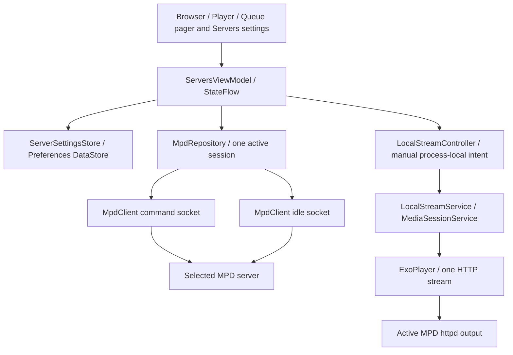

# Architecture

## Existing project

One Android app module, `:app`, under `com.github.jschbe.simplempdplayer`. Kotlin, Compose and Material 3 were already configured. The application ID, namespace, SDK levels, wrapper, repositories and toolchain are preserved.

| Setting | Configuration |
| --- | --- |
| Android | Minimum SDK 31; compile/target SDK 37 |
| Build | Gradle Kotlin DSL, Gradle 9.6.0 with distribution checksum, AGP 9.4.1 |
| JVM | Gradle daemon JDK 25 via Foojay; Java source/target compatibility 11 |
| Compose | Plugin 2.2.10; BOM 2026.02.01 |
| Existing AndroidX | Core KTX 1.19.1, Lifecycle 2.11.0, Activity Compose 1.13.0 |
| M4 additions | Media3 ExoPlayer and Session 1.11.1 |
| M1 additions | Lifecycle ViewModel/Runtime Compose 2.11.0, Preferences DataStore 1.3.0, Coroutines Android/Test 1.10.2 |

Dependencies remain in `gradle/libs.versions.toml`, with stable versions. Google and Maven Central remain the dependency repositories. No MPD library, database, serialization library or DI framework is added. See [requirements](REQUIREMENTS.md) for scope and [README](../README.md) for running the app.

## M1–M5 components and data flow

- `MainActivity` obtains a lifecycle-owned `ServersViewModel`; Compose collects its StateFlow with lifecycle awareness. Activity recreation/recomposition does not create additional connections.
- `ServersViewModel` retains M1 profile editing, persistence and permission handling. The header dropdown changes the persisted selection. Saving a new or edited profile atomically selects it and explicitly reconnects once, even for an unchanged endpoint. A local 500 ms ticker interpolates progress from the last server snapshot using monotonic time, and runs only while connected/playing.
- `ServersApp` uses one HorizontalPager state for Browser–Player–Queue and directly tappable Material 3 tabs. Player is the initial page. With no selected server, it opens Servers instead; Servers is a settings subview with normal Back handling, not a fourth tab. Settings also contains Appearance and the Sleep timer dialog.
- `PlayerScreen` displays server metadata and confirmed state. Seek/volume gestures keep local thumb state and send one command on release; network updates do not override an active seek drag. `QueueScreen` uses MPD IDs as stable keys, locates the current entry on first visible load per server, then preserves user scroll position. Move up/down avoids a drag-and-drop dependency.
- `MpdRepository` owns one session containing command/event clients and an operations Mutex. Old sockets and the idle coroutine are closed/cancelled on switch. Captured session identity guards every asynchronous publication, including command errors; old replies cannot modify a new server's UI. Switching clears the snapshot immediately.
- `MpdModels` defines status, song metadata, queue entries, snapshots and the small `PlayerAction` event type. `MpdData` parses repeated tags and optional fields without flattening queue entries by path. Invalid critical IDs/status numbers fail in a controlled way; unavailable durations/mixers stay nullable.

`PlayerApplication` constructs the production repository with a process-owned Main/SupervisorJob scope and the local stream controller. The Activity ViewModel observes this shared repository; clearing/recreating the Activity cannot destroy a background receiver or stop its metadata updates. A new Activity adopts the already connected endpoint without reconnecting. JVM ViewModel fixtures retain their independently owned repository and close it on clearing. Process death closes all resources; startup restores only profiles/selection and reconnects MPD, never local audio. Without local audio no foreground service keeps the process alive; idle control sockets are process-local and may be reclaimed by Android.

## Profiles and persistence

`ServerProfile` has a stable UUID, name, host, MPD port and HTTP stream port. Validation runs without DNS access. Hostnames, IPv4 and IPv6 are accepted; schemes, paths, embedded ports, whitespace and control characters are rejected. Bracketed IPv6 is normalized; international hostnames are converted to ASCII. Port range is 1–65535.

A single application-context `preferencesDataStore` instance stores:

| Key | Value |
| --- | --- |
| `server_profiles_v1` | Ordered text rows: UUID, name, host, MPD port, stream port, separated by tabs; rows separated by newlines |
| `selected_server_id` | UUID of the selected profile, absent when none is selected |
| `recovered_corrupt_file` | Recovery marker when DataStore replaces an unreadable corrupt file |
| `theme_mode` | SYSTEM (default), LIGHT or DARK |

Control characters are invalid profile input, so field delimiters need no custom escaping. No credentials are stored. Decoding skips invalid/duplicate rows, clears dangling selections and reports recovery. Wrong preference types are also treated as invalid input. A successful edit writes a sanitized snapshot. DataStore file corruption resets to empty settings with a warning; an ordinary IO read error shows Retry and disables edits rather than silently replacing data. Changes use DataStore's atomic edit operation.

## Server UI addendum

`ServersViewModel` accepts the settings store, connection factory and permission check explicitly; MainActivity constructs it through the normal ViewModel factory. This keeps the existing lifecycle and permits JVM tests without an Android Application. A settings write suppresses observer-driven connection changes until the atomic edit completes. Save then closes the editor and starts exactly one explicit connection; selection/order/theme edits synchronize only if the selected endpoint changed.

A single empty-list transition flag opens the shared Add server dialog on first load or after deleting the last profile. Cancel does not reset that flag, so recomposition, theme changes and repeated settings emissions cannot reopen it. A new process or a later nonempty-to-empty transition can open it again. Startup with existing profiles never opens it automatically.

The editor's Test action calls `MpdRepository.testConnection`: a temporary client validates greeting/ping and closes in finally, without persisting or touching the active command/idle session. Testing disables repeat submissions and form edits; Cancel cancels the probe. Save selects the stored profile even when its subsequent connection fails. Errors remain in the ordinary connection state. Monotonically increasing operation/dialog tokens reject stale probe results and Connected/Connection failed toast notices; SharedFlow does not replay old notices after Activity recreation.

Servers settings uses the stored row order. Long-press gestures exist only on each drag handle; local visual ordering and edge scrolling run during the gesture. Drop commits the ID order once; cancellation/write failure restores stored order. The store tolerates stale order lists without losing newly added profiles or reviving deleted ones. Reordering does not change selection or reconnect. The header dropdown uses that same persisted order.

Appearance writes the theme preference and applies it directly around the entire Compose hierarchy. SYSTEM follows Android's theme; LIGHT/DARK override it. Existing Material 3 dynamic colors remain in use. No additional theme framework or dependency is introduced.

`SimpleMPDPlayerTheme` updates the Activity window's status/navigation-bar icon appearance in a Compose SideEffect using the effective dark-mode value. It leaves the existing edge-to-edge/inset configuration intact and responds to both explicit and system theme changes.

## M3 browser and queue additions

`MpdBrowserData` splits `lsinfo` records at file/directory/playlist boundaries, reuses song metadata parsing and sorts directories before tracks. Playlist records are skipped with a notice; unknown metadata is ignored. `LibraryEntry` distinguishes directories from tracks; neither requires a queue ID. Unicode and literal backslashes are preserved. The existing `MpdProtocol` argument quoting and `MpdClient` exchange/timeout limits are unchanged. See the [MPD protocol](https://mpd.readthedocs.io/en/stable/protocol.html#the-music-database) for directory listings.

`MpdRepository.browser` is a StateFlow collected into `ServersUiState`. Browser visibility asks the ViewModel to load only when the current listing has not been loaded. Root uses `lsinfo` without arguments; navigation/retry sends `lsinfo <URI>`. Only the current directory's entries are held in memory. Ordinary queue updates, tab changes and recomposition do not reload it; explicit navigation/reconnect obtains fresh data. Library database changes are not watched automatically in M3.

Each session has a child Job for app commands/browser work. Switch/failure closes both sockets and cancels that work. A session generation invalidates UI menus/confirmations and rejects stale UI requests. Directory request numbers additionally reject superseded replies: Up/Back may request a parent while a read is pending. The pending exchange finishes under the operations Mutex, then only the newest queued directory request runs. Navigation does not cancel a healthy shared command socket. A directory ACK is a browser-local error; malformed/transport responses fail the session normally.

`BrowserScreen` renders path/Up, loading, empty, unsupported-playlist and retry states, with a vertical LazyColumn and lightweight queue menus. Its scroll state survives tab changes for the current directory. The existing pager still starts on Player. Back handling is active only for visible Browser subdirectories; dialogs and Servers retain their normal handling.

Append sends one `add <URI>` for files or directories; recursion belongs to MPD. Confirmed replacement sends `clear`, then `add <URI>`, then queue/status readback while holding the same operations Mutex used by playback, browsing, heartbeat and idle refresh. It sends no play command. This excludes app-originated interleaving only: other clients may change MPD state, and there is no transaction or rollback. The operation tracks acknowledged clear/add stages and retains explicit failure feedback. After a confirmed clear, a failed or unconfirmed add is a partial replacement; recursive add may already have inserted some tracks. Lost clear acknowledgements are reported as uncertain. A successful add followed by failed readback is distinguished from an add failure. No mutation is automatically retried, including after switching servers.

## M4 local audio and session policy

`LocalStreamController` owns only ephemeral enable intent, an increasing generation, request and state StateFlows. Its backend can start/stop local audio but has no MPD command API. Profile URL construction revalidates and normalizes the profile, uses the HTTP root path and stream port, IDN ASCII conversion and proper IPv6 brackets through `URI`; it accepts no scheme/path/credentials/controller-provided URL. The service reads a trusted in-memory request; its Intent contains only the generation. Stream intent is never persisted. `ServersViewModel.connect` disables/releases local audio synchronously before every explicit reconnect/Save/switch/delete, and includes the stream port in endpoint-change detection. Reordering/theme changes do not interrupt playback. The process owner forwards repository snapshots to the controller even without a visible Activity. Lost control connectivity stops local listening; stream failures do not call the repository or close MPD sockets. Generation guards reject stale errors and service destruction.

`LocalStreamService` creates exactly one ExoPlayer and registers one MediaSession with the service. Media3 owns the media notification and foreground promotion. It uses standard media/music audio attributes with automatic audio focus, becoming-noisy handling and network wake mode. Local volume is Android's music stream, separate from MPD setvol. Permanent focus loss/noisy events disable/release local audio; transient suppression is reported and ExoPlayer may resume on focus return. No focus/route/system callback sends MPD commands. Default Android routing covers speaker, wired headphones and Bluetooth; real accessory behavior still needs manual acceptance.

The service prepares the profile stream even when MPD is paused, but `playWhenReady` follows confirmed MPD PLAYING only. Paused/stopped/unknown snapshots pause local output and report Waiting for MPD when ready. HTTP can still supply silent MP3 frames while MPD is paused. On resume ExoPlayer stops/prepares the same item to reopen the live origin and discard accumulated silence. Metadata updates use `replaceMediaItem` only when metadata changed, without restarting an unchanged stream. Embedded MP3 ID3/artwork extraction is disabled; item metadata from MPD takes precedence over stream tags. There is no local track progress: a small standard ForwardingPlayer adapter exposes unknown duration and zero positions. App progress remains MPD-derived. MediaController clients can internally interpolate a position from playback speed; the unknown duration and unavailable seek commands prevent an independent stream scrubber in system UI. Audio buffering and MPD event timing can still make sound lag behind the UI.

All controllers, including the media-notification/platform controller, receive only current-item/metadata/timeline read commands and no custom session commands. No play/pause/stop/seek/queue/item-replacement commands are offered. This conservative policy avoids interpreting a local decoder pause or headphone key as remote MPD intent. Use app transport controls for MPD; open the notification to reach them. The session reflects local suppression/buffering and MPD pause via the standard ExoPlayer state and identifies the MPD state in its subtitle. No transport routing bridge, custom queue/player engine, playback-resumption receiver or boot restart exists. The service is non-exported; even same-UID controllers cannot create/authorize a new player without manual app intent.

HTTP uses Media3's default HTTP data source (8 s connect/read deadlines; cross-protocol redirects disabled), zero automatic load-error retries and a 20 s continuous connect/buffering watchdog. Sanitized error categories never expose response bodies/endpoints. Media3 library logging is disabled centrally so source exception details cannot bypass this policy. EOF, decode/transport failure, permission/start failure or loss of MPD terminate local reception and require a manual retry. Off immediately releases player/session, removes the notification/foreground state and stops the service. It is START_NOT_STICKY. Active playback survives task removal; an idle/paused task removal stops it. Android may reclaim a long-paused service, and foreground/audio-focus restrictions can block a background resume. The app reports failure and requires opening the app/retry rather than circumventing platform rules. The target/min SDK and Android routing/focus rules are unchanged.

References: [Media3 stable releases](https://developer.android.com/jetpack/androidx/releases/media3), [MediaSessionService lifecycle/notification/controller commands](https://developer.android.com/media/media3/session/background-playback), [audio focus](https://developer.android.com/media/optimize/audio-focus), [ExoPlayer error policy](https://developer.android.com/media/media3/exoplayer/customization).

## M5 sleep timer

`PlayerApplication` explicitly constructs one process-scoped `SleepTimerController` independently of the interactive repository, local stream and Activity. It observes timer/profile DataStore flows so edits invalidate alarms even without a visible Player. `ServersViewModel` exposes the controller StateFlow and UI events; only an active timer has a local display ticker, with no network polling or background service. `SleepTimerDialog` uses existing Material 3 theme/strings and one dialog for the switch, presets, custom input, target, countdown, estimated time and status. No dependency or permission is added.

`SleepTimerStore` owns a separate `sleep_timer.preferences_pb` Preferences DataStore containing last applied minutes (30 by default; 1–1440), one validated timer record, and a recovery marker. The record holds a UUID generation, profile ID/name/host/MPD port/HTTP port snapshot, boot count, elapsed start/deadline, status and sanitized error category. It contains no credentials. The endpoint snapshot is needed for the single alarm, not a second interactive server session. Both backup rule formats exclude this file from cloud backup/device transfer to prevent replay on another device. Corrupt records/types are recoverable; ordinary IO read failures expose Retry without replacing data.

Time uses `SystemClock.elapsedRealtime()` including deep sleep. `Settings.Global.BOOT_COUNT` identifies the boot; if unavailable, a new timer cannot start. Startup cancels a pending record with another boot or an invalid elapsed reference. The wall clock is used only for a fresh estimated due time. Active state is restored without re-registering/resetting the OS alarm. Zero remaining time stays Due/Waiting for Android until actual delivery. Force Stop is not guaranteed survivable; a missing PendingIntent is detected, but an extant PendingIntent does not prove Android will deliver the alarm.

`AndroidTimerScheduler` uses one explicit, immutable broadcast PendingIntent with a fixed identity and the generation in extras. Replacing it cancels the old PendingIntent, then uses `setAndAllowWhileIdle(ELAPSED_REALTIME_WAKEUP, deadline, pendingIntent)`. The receiver is non-exported. No SCHEDULE_EXACT_ALARM, USE_EXACT_ALARM, RECEIVE_BOOT_COMPLETED, exact-permission screen or new foreground service exists. Each registration first persists ARMING, cancels the previous OS token, schedules the new token and commits ACTIVE. These two systems cannot be committed atomically: interrupted ARMING is detected and cancelled, never silently rearmed. Cancellation commits terminal state before cancelling the OS token; even an event already queued is rejected by generation/status checks.

A shared coroutine Mutex serializes timer operations and every `ServerSettingsStore` write across instances. Profile selection does not change the bound target. Host, either port or deletion cancels the alarm; renaming/sorting/theme changes do not. A duration change keeps the original target and starts a new generation/deadline. The observer re-reads current state under the mutex, and dispatch revalidates the current profile under that same lock. Delayed observer events cannot cancel a newer timer. Early, stale and duplicate events send nothing.

`SleepTimerReceiver` uses `goAsync()` and a single IO coroutine bounded to 8 s, finishing the PendingResult in finally. It does not initialize an Activity, ExoPlayer or interactive MPD connection. `MpdRepository.pauseForTimer` creates a disposable existing `MpdClient` with 2 s connect/read deadlines and a 2.5 s exchange limit; the complete resolver/connect/greeting/pause operation has a 6 s deadline. Android's cancellable `DnsResolver` handles hostnames rather than a potentially unbounded blocking JVM resolver; numeric IPv4/IPv6 endpoints bypass DNS. One resolved address is attempted, with no retry/fallback loop. Existing greeting, UTF-8, response bounds, command quoting and ACK parser are reused. The sole command is MPD `pause 1` (the existing encoder quotes its numeric argument as `pause "1"` on the wire). There is no status-dependent toggle or Play/Stop/queue/seek/output command. Empty acknowledged response is required for success; password/permission ACKs have an explicit unsupported-authentication error.

Delivery persists DELIVERING before IO while holding the mutation lock until its bounded outcome is stored. If cancellation/restart/profile edit commits first, the old alarm cannot send. If delivery claims first, UI changes wait for that attempt (normally under 6 s plus local persistence); an already transmitted command cannot be recalled. A process killed after claim may have sent Pause without persisting its acknowledgement. Startup marks that claim uncertain and never replays it, even though explicit Pause is idempotent. Timeouts/lost replies also do not imply the server was unchanged. Storage failure cannot fabricate success. There is no automatic retry, notification, background toast or second foreground service. M4 changes only through its ordinary server pause snapshot/idle observation.

Doze/Battery Saver may delay inexact alarms substantially. The short temporary alarm allowance does not guarantee network access or delivery, and OEM restrictions, permission revocation, Force Stop and unavailable DNS/LAN/MPD remain limits. No receiver coroutine is intentionally detached after completion. Disk/OS stalls and process termination cannot be made transactional with a remote server. These limitations are shown in the UI and terminal errors remain inspectable after reopening.

References: [AlarmManager and inexact idle alarms](https://developer.android.com/reference/android/app/AlarmManager#setAndAllowWhileIdle(int,long,android.app.PendingIntent)), [BroadcastReceiver.goAsync](https://developer.android.com/reference/android/content/BroadcastReceiver#goAsync()), [BOOT_COUNT](https://developer.android.com/reference/android/provider/Settings.Global#BOOT_COUNT), [DnsResolver](https://developer.android.com/reference/android/net/DnsResolver).

## Launcher icon

The supplied `SimpleMPDPlayer.png` above the repository remains untouched. Derived resources separate the bright Play/stream artwork from its precomposed rounded tile. Android supplies the only adaptive mask; the background is a full-bleed dark gradient, and the symbol is padded within the adaptive safe area. Extraction and replacement of the original baked background are pragmatic approximations, not lossless source-layer recovery.

Both launcher variants reference the new adaptive layers. API 33+ resources add a monochrome silhouette for themed icons. Five legacy WebP density variants are included. Generated previews check the circular mask; actual launcher/system-settings appearance still needs a device check when one is available. No image-processing runtime or app dependency is added.

## TCP protocol, synchronization and state

The existing custom TCP client and Android-compatible ACK regex remain in use. UTF-8 decoding, greeting validation, quoting/escaping, bounded responses, IO dispatching and cancellation cleanup are shared by all commands. The text exchange preserves ordered/repeated fields. No MPD library or binary/cover protocol is added. Protocol reference: [MPD specification](https://mpd.readthedocs.io/en/stable/protocol.html).

A client Mutex covers the complete write/flush/read exchange through `OK` or `ACK`. Ordinary operations retain the M1 5-second connect/read and 10-second exchange limits. The separate event client sends `idle` for player, playlist, mixer and options and waits without the short read/exchange deadline; closing it unblocks cancellation. TCP keepalive is enabled. A 15-second ping on the command connection retains M1 liveness detection; there is no per-second network polling or automatic reconnect.

Connection setup validates/pings the command socket, opens the event socket, and loads the initial snapshot. A session operations Mutex groups commands and snapshot refreshes so idle updates cannot split a local command/readback sequence. Each refresh reads status, current song, queue when its version changed, then status again. If the queue version/song identity changed during loading, it retries at most three times. Queue IDs and length are checked; no snapshot is fabricated from partial replies.

Player actions map to explicit commands: state-aware play/pause, stop, previous, next, seekcur, random, repeat and setvol; queue actions use playid/deleteid/moveid/clear. Play/Pause reads current server state before deciding. Seek checks song identity and duration; move resolves the ID against a fresh queue before choosing the adjacent position. Another client's edits cannot be locked out remotely, so ACK failures still require refresh. Mutating commands are never blindly replayed.

Controls disable while disconnected/loading or a user command is pending. A completed ACK rejection leaves the connection usable, displays a command error and refreshes actual server state. A transport, malformed-protocol, security or idle-listener failure closes both sockets and exposes a failed state with manual reconnect. The last snapshot may remain visibly marked as stale; progress stops advancing. An idle ACK also fails the session rather than silently losing external updates.

Responses retain M1's limits of 64 Ki characters per line and approximately 1 Mi characters / 10,000 fields per exchange. Exceptionally large directories/queues and continuously changing snapshots can therefore produce a controlled synchronization error. DNS cancellation and silent network blackholes remain subject to the platform resolver/TCP behavior. M3 does not promise unlimited listing/queue sizes or durable background connections. Large recursive adds are subject to the existing command timeout and may have an uncertain outcome on timeout.

## Security and permissions

The app declares `INTERNET` and, for Android 17 / API 37 and newer, `ACCESS_LOCAL_NETWORK`. The latter is necessary for direct LAN sockets at the existing target SDK 37. Until it is granted, server connections show an actionable permission error; the user can request access from the Servers screen. Permission changes are rechecked when the Activity resumes. See [Android local network permission](https://developer.android.com/privacy-and-security/local-network-permission). Direct MPD TCP is potentially unencrypted. Use a trusted LAN or a separately configured secure tunnel; the app never publishes ports or configures the server. M4 adds FOREGROUND_SERVICE, FOREGROUND_SERVICE_MEDIA_PLAYBACK and WAKE_LOCK for Media3 background audio. Media-session notifications are exempt from the Android 13 notification runtime permission, so POST_NOTIFICATIONS is not requested. M5 adds one non-exported alarm receiver without new permissions. There are still no passwords, Keystore, encryption dependency, boot receiver or exact-alarm permission.

`network_security_config.xml` deliberately enables cleartext in the base configuration. User profiles permit arbitrary hostnames, IPv4 and IPv6; Android static domain configuration cannot enumerate future user-entered endpoints at runtime. This application-wide opt-in is limited in purpose to the manually enabled HTTP receiver; no credentials are sent and there is no WebView, telemetry or other HTTP feature. It does not secure the LAN transport. Reference: [Android network security configuration](https://developer.android.com/privacy-and-security/security-config#CleartextTrafficPermitted). Existing Android backup settings are preserved; credential storage and backup exclusions must be designed before password support is introduced.

## Later milestones

MPD queue/status snapshots and directory listings are not stored as a local playlist or music library.

M5 implements the single inexact sleep timer described above. Password support remains future work.

## Open decisions for later work

1. Password storage/authentication and backup/device-transfer exclusions.
2. Paging/windowing for exceptionally large queues; minimum supported MPD protocol version.
3. Additional HTTP encoder/device validation; M4 intentionally supports only a root-path stream and a read-only system session.
4. Wider OEM/Doze/permission testing; M5 deliberately makes one bounded delivery attempt without retries.
5. Optional directory refresh/database-event observation and paging for exceptionally large listings.

## Verification

JVM tests additionally cover atomic Save/activate/connect, independent probes, stale notices, empty-list setup transitions, ordering and theme persistence. They also cover profile/storage behavior, protocol parsing, playback/queue commands, repeated/Unicode metadata, empty/duplicate-path queues, interpolation, ACK/transport failures, external idle updates, cancellation and stale replies during server switches. Loopback socket tests verify that idle has no ordinary deadline and does not block commands.

M3 JVM tests cover mixed lsinfo records, missing metadata, skipped playlists, exact special-character commands over loopback sockets, ACK recovery, lazy loading, superseded reads, append/replace/readback, serialization against browser/idle/heartbeat work, partial/uncertain failures and cancellation/stale results on switches. Compose fixtures cover folder/Up/Android Back navigation, pager behavior, action menus, confirmation/cancellation, empty/loading/error/disconnected states, stale dialogs and scroll preservation. A window-level test checks system-bar icon contrast after explicit and simulated system theme changes. No automated browser test uses a live MPD server or the normal app's stored profiles.

Android tests cover the ICU ACK regression, player/queue parsing and controlled Compose fixtures for tabs, swipes, empty state, queue selection/actions, settings and seek dragging. Additional controlled ViewModel/UI fixtures cover setup, probe/save, header selection, handle-only dragging, deletion, appearance and launcher-resource rendering. They do not access a real MPD server or stored profiles.

Instrumented tests use the `deviceTest` build type with application-ID suffix `.devicetest`; the normal app is not their install/uninstall target. The same source is used for the debug APK and JVM tests. Because this project's AGP exposes unit tests for the configured test build type, the JVM task is `testDeviceTestUnitTest`. The existing Compose UI test manifest is reused only for the isolated test host. M4 adds only the two Media3 dependency coordinates and the permissions described above.

### M4 verification and acceptance limits

JVM coverage includes hostname/IPv4/IPv6/IDN URL construction and rejected profiles, manual intent, connect/buffer/ready/off/error state changes, manual retry, stale generation callbacks, metadata updates, connection loss and synchronous release before server switching/reconnect. ViewModel tests prove local enable/disable does not send MPD commands. Android tests use a generated CC0 mono 44.1 kHz / 128 kbit/s MP3 tone over an in-process HTTP server and a read-only MPD fixture. They cover real decoding, buffering, initial MPD pause, pause/resume, HTTP 503, stalled HTTP/read timeout, no retries, Activity recreation without another HTTP request, Home/screen-off reception, foreground/service/socket shutdown, reconnect/deletion, MPD metadata/unknown stream duration, rejected MediaController commands and media keys, transient/permanent audio focus and unauthorized service/controller starts. Compose tests cover the independent listening switch, status/error/retry and disconnected state. Fixtures only write to the isolated test app's profiles.

`LiveStreamReadOnlyTest` is optional and skipped without explicit `readOnlyStreamHost` instrumentation arguments (optional `readOnlyMpdPort` / `readOnlyStreamPort`). It never persists its endpoint. It passively reads HTTP and starts only repository read/idle traffic, then prepares the local decoder. It never invokes MPD transport/queue/options/volume/output mutations and makes no claim to restore concurrently changed server state. Do not use a physical device for this test. The live server's paused state proves neither audible music nor end-to-end speaker output.

Emulator validation uses the existing Medium Phone AVD, API 36, and the `.devicetest` app. Hardware Bluetooth/headphone switching, actual becoming-noisy delivery and audibility on a phone remain manual acceptance checks; a shell broadcast is not a substitute for a genuine route change. API 31/37 runtime behavior is built/linted but not exercised on those OS versions in this run. HTTP/MPD reachability, encoder support, stream latency, OEM battery policies and long-pause/background focus restrictions remain environmental limits. This M4 verification predates M5; password support remains excluded.

Verified on 2026-11-22: debug build, all 90 JVM tests, the complete 36-test Android fixture suite and a subsequent focused eight-test service run passed on Medium Phone / API 36. Lint completed with zero errors and 19 warnings (including the deliberate cleartext configuration and existing dependency/resource warnings); diff whitespace checks passed. The separate opt-in live test also passed: HTTP 200 / audio/mpeg, 16,384 bytes received by Android and Media3 ready in WAITING_FOR_MPD while the server reported PAUSED. A NUC-only passive HTTP check received 65,536 bytes. No live MPD mutations, SSH, physical-device testing or writes to normal app profiles were performed. This does not verify audible music, physical routing, minimum-API runtime behavior or API 37 permission enforcement.

### M5 verification

Verified on 2026-11-22: debug build, 111 JVM tests and Lint passed (0 errors, 19 existing/deliberate warnings). The full Medium Phone API 36 suite executed 42 Android tests successfully; the optional M4 live-LAN check and two host-driven process-probe phases were skipped unless explicitly enabled. The final focused run passed all six M5 Android tests. All active timer tests used loopback fake MPD only; the real server was neither contacted nor modified during M5. No physical device or normal app profile was used.

JVM cases cover duration/default/presets/invalid custom input, one alarm, start/cancel/reset, wall-clock changes and overdue display, same-boot reload without rescheduling, reboot/invalid monotonic references, missing alarm/boot information, original target across selection and duration changes, rename/order versus endpoint edit/delete, old/early/duplicate events, serialized cancellation/edit versus an already claimed dispatch, interrupted registration/delivery, ACK/authentication/network/timeout errors and ordinary storage failure. Disk reload and malformed timer records are checked. Loopback wire tests validate the greeting, exactly one explicit Pause, no other mutation and socket closure.

Android cases cover creation/cancellation/real PendingIntent identity, receiver execution without Activity or local audio, duplicate delivery, stale/cancelled PendingIntents, endpoint invalidation, persisted ACK/read-timeout failures, absence of exact/boot permissions and exported receiver, presets/custom validation, Activity recreation, stored duration, and System/Light/Dark dialog behavior. Receiver tests shorten only their test record's deadline and explicitly send the real PendingIntent; they do not promise a fixed Doze execution delay.

The opt-in `SleepTimerProcessProbe` was also exercised by a host driver with an ephemeral NUC loopback fake (emulator bridge only). After preparation, a normal `.devicetest` Activity process was terminated under its own test UID without Force Stop, then restarted normally: PID changed while UUID, elapsed deadline and OS alarm registration remained unchanged, and Player displayed the restored countdown. The fake received zero mutations; probe cleanup cancelled the timer. This verifies process survival rather than just reconstructing a controller in the same process. Reboot detection is unit-tested; a physical reboot, real Doze/OEM delays and API 31/37 runtime behavior are not exercised here.
